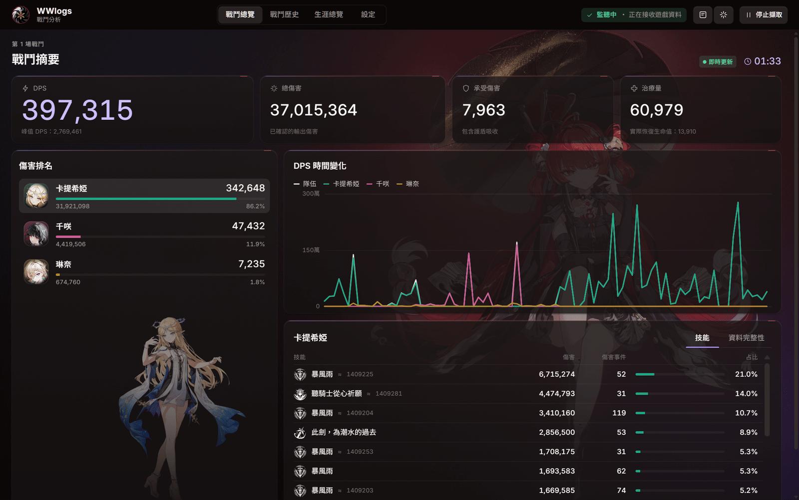
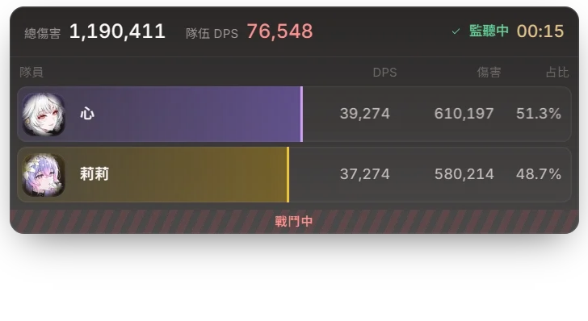
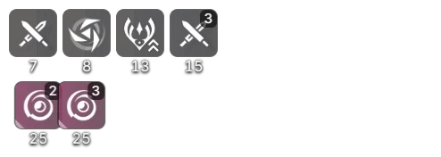
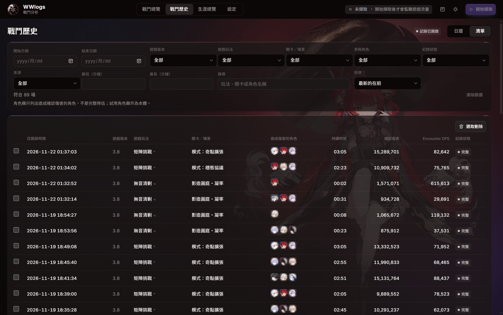
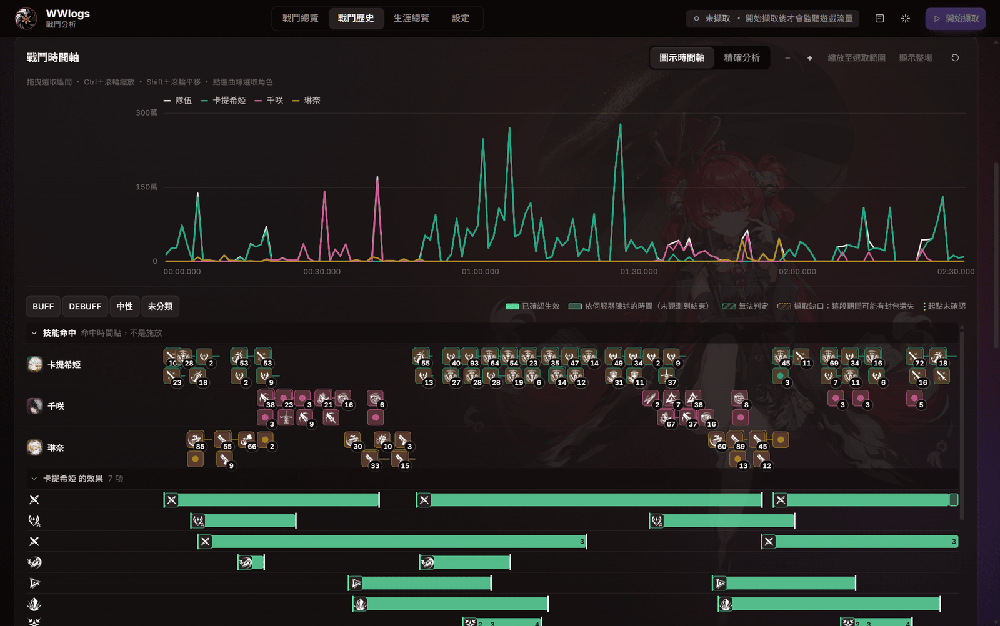
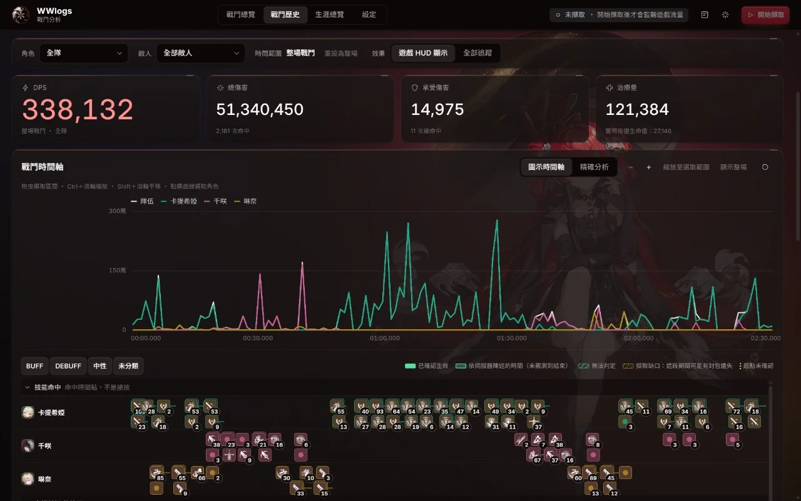
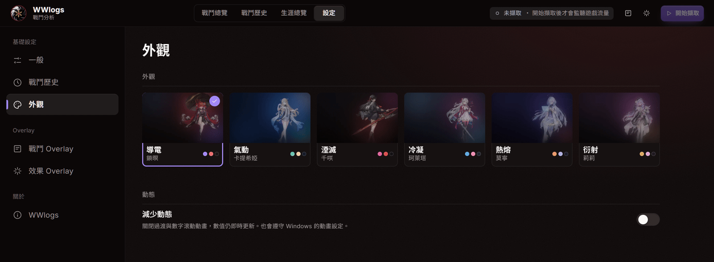

<p align="center">
  
</p>

<h1 align="center">WWlogs</h1>

<p align="center">A combat log and analysis tool for Wuthering Waves on PC: live DPS, BUFF / DEBUFF tracking and encounter review</p>

<p align="center">
  
  <a href="LICENSE"></a>
</p>

<p align="center">
  <a href="README.md">繁體中文</a> · <a href="README.en.md">English</a> · <a href="README.ja.md">日本語</a> · <a href="README.zh-CN.md">简体中文</a> · <a href="README.ko.md">한국어</a>
</p>

WWlogs is a combat analyzer for the PC version of Wuthering Waves. On Windows, it reads the game's network traffic through Npcap and shows, in real time, the DPS, damage and skill breakdown of your team and each character, along with the BUFF / DEBUFF statuses on the game's HUD. Every finished encounter is saved on your PC, so you can review, filter and compare it later.

> [!CAUTION]
> WWlogs is an unofficial third-party tool; assess the risks of using it yourself. Before you use it, please read the [Disclaimer](#disclaimer) and [Safe use](#safe-use).



## How it started

I spent the better part of a year saving up 160,000 Astrite to pull for Suoming, planning to make her my main DPS. Once I actually played her, I found her buff trigger conditions were way stricter than I expected: if your hits don't land inside her empowering buff, the damage is basically trash. And in the middle of a fight, it's really hard to tell whether the buff actually triggered.

So, in a fit of rage, I got… a little angry. Then I thought: why not just write my own tool, record the fights and analyze them directly? I only meant to solve that one problem, but the features kept piling up, and it eventually turned into the WWlogs you see today.

## Features

### Live combat overlays

Two small windows that sit on top of the game, so you can follow the numbers during combat without switching windows.

- **Combat Overlay**: total damage, team DPS and combat time, plus each member's DPS, damage, share and damage taken; members are sorted by damage and change places in real time when the ranking changes.
- **Effects Overlay**: the statuses on the game's HUD, shown with the game's own icons. The first row holds buffs and neutral statuses, the second row debuffs; each icon shows its estimated remaining seconds and its stacks, and statuses applied to enemies are marked separately.
- Each overlay can be shown or hidden on its own and set to stay always on top, let mouse clicks pass through, and use its own background opacity and display scale; in Edit Mode you drag it into place and resize it.

<p>
  <br>
  
</p>

### Dashboard

- **Combat summary**: DPS (with the 1-second peak DPS), total damage, damage taken (including shield absorption) and healing.
- **Damage ranking**: each character's DPS, damage and share.
- **DPS over time**: per-second DPS curves of the team and each character.
- **Skill breakdown**: choose a character to see each skill's damage, number of damage events and share; damage from negative statuses is listed separately.
- **Data integrity**: if packets were lost during the capture, DPS is marked as a lower bound (≥); when it cannot be calculated reliably, it is not shown.

### Combat history

- Every finished encounter is saved automatically, and you can browse them on an activity calendar or in a list.
- The list can be filtered by date, game version, mode, stage or scene, characters, record status and duration, searched by mode, stage or character name, and sorted by time, DPS, damage or duration.
- Each encounter records the game version, the mode, the stage or scene, and the main enemy.
- **Comparison**: compare up to 4 encounters side by side by duration, confirmed damage, DPS, peak DPS, character damage and skill damage distribution.
- You can delete a single encounter, several encounters or the whole combat history.



### Encounter analysis: DPS trends, skills and the BUFF / DEBUFF timeline

Open any finished encounter in the combat history to analyze it afterward.

- **Combat timeline**: the DPS curves of the team and each character, every skill hit and the active intervals of each effect, laid out on one timeline that you can zoom and pan.
- **Range analysis**: drag across the timeline to select any range, and DPS, damage, the character ranking and the skill and effect statistics switch to that range; you can also look at one character or one enemy only.
- **Skills**: each skill's damage, share, hits, largest hit, average hit and distribution over the encounter.
- **Effects**: each effect's holder, coverage, highest stack and number of applications. On the timeline, active intervals are marked by their evidence as "Confirmed active", "By the time the server stated" or "Cannot be determined".
- **Events and enemies**: every damage, healing and effect change, one by one, and for each enemy the damage it took, the hits it received and the damage it dealt to the team.





### Career overview

For a period (last 7 days, last 30 days, all time or custom), it sums up the number of encounters, confirmed damage, combat time and active days, and lists your personal records (best Encounter DPS, most confirmed damage, best 1 s peak DPS, largest hit), how each character performed, the damage-dealing lineups that fought together, daily trends, and modes and stages. Personal records come from complete records only.

### Settings, themes and languages

- **Language**: 繁體中文, 简体中文, English, 日本語 and 한국어, or chosen automatically from the Windows display language. Character, skill, enemy and mode names are shown in the same language.
- **Appearance**: several element themes with Wuthering Waves characters as backgrounds; you can reduce motion, and WWlogs also follows the Windows animation setting.
- **Capture**: the network interface, starting the capture when WWlogs launches, and the update interval of the combat information.
- **Combat history**: you can turn recording off or clear the whole history.



## System requirements

| Item | Requirement |
| --- | --- |
| Operating system | Windows 64-bit (x64); developed and tested on Windows 11 |
| Packet capture | [Npcap](https://npcap.com/), installed separately |
| Runtime | Microsoft Edge WebView2 Runtime (included with Windows 11) |

WWlogs supports only the confirmed current game version. If a game update brings up a message that the game version is not supported, wait for or download the matching official WWlogs update.

## Installation and use

This is how players use WWlogs; there is nothing to compile.

1. Install [Npcap](https://npcap.com/); the default options are fine.
2. Download `WWlogs.exe` from [Releases](https://github.com/SindouYukina/WWlogs/releases). WWlogs is a single executable and needs no installation.
3. Open `WWlogs.exe` and, in "Settings → General", choose the network interface that your game connection uses.
4. **Before you log in to the game**, click "Start capture" at the top right. You can also turn on "Start capture when WWlogs launches" in "Settings → General".
5. Log in to the game and start fighting. The Dashboard and the overlays update in real time, and every finished encounter is saved to "Combat history" automatically.

- The two icon buttons on the right of the top bar show or hide the Combat Overlay and the Effects Overlay. To move or resize an overlay, enter Edit Mode in "Settings → Combat Overlay" or "Settings → Effects Overlay".
- If you start capturing after you have logged in to the game, WWlogs tells you that it missed the login. Go back to the game's login screen and log in again; there is no need to stop the capture.
- If WWlogs cannot find Npcap, it shows a link to the official Npcap download. If you restricted Npcap to administrators when you installed it, run WWlogs as an administrator.
- Only one WWlogs runs at a time; opening it again brings the window that is already open back to the front.

## How it works

WWlogs captures the network traffic between the game client and the server through Npcap and parses the combat data in it on your PC; damage figures are the results the server confirmed. For the technical behavior of WWlogs and what to keep in mind when you use it, see [Safe use](#safe-use).

WWlogs must see the game's login to parse the combat data of that connection, so start the capture before you log in to the game.

## About the numbers

- **DPS (Encounter DPS)**: the confirmed damage divided by the actual time that passed from the start to the end of the encounter; time spent on animations, character switches and transitions is included.
- **Total damage**: only damage the server confirmed is counted. Damage whose owner is unknown is not included in the total damage and is shown separately.
- **Hits**: the skill table counts damage hits, not skill casts; WWlogs does not record skill casts.
- **BUFF / DEBUFF**: remaining seconds are estimates. WWlogs shows only the state and timing of effects; it does not estimate how much damage an effect contributes and does not calculate rDPS. Most effects have no name in the game data, so effects are shown with their game icons, and the analysis pages also list the effect ID.
- **"≈" next to a name**: the name was inferred from the game data and may not be the item's own official name; hover over the "≈" to see an explanation.
- **Comparing numbers**: DPS varies with the mode, stage, enemies and length of the encounter, so numbers from different conditions cannot be compared directly.

## Data and privacy

- Settings and combat history are stored only on this PC (`%LOCALAPPDATA%\WWlogs`).
- WWlogs does not upload combat data and has no telemetry or automatic updates. It connects to the internet only when it detects that Npcap is not installed, to look up the latest Npcap installer on the official Npcap website and GitHub.
- Combat history stores the results of each encounter, every confirmed damage and healing result, and effect changes. It does not store raw network packets.

## Safe use

**Technical behavior**

- WWlogs captures the network traffic between the game client and the server through Npcap and does not modify the captured packets.
- WWlogs does not read or modify game memory, does not inject into the game process and does not modify game files.

This is how WWlogs is technically designed. It does not mean that using it carries no account risk, nor that KURO GAMES has given its permission; please also read the [Disclaimer](#disclaimer).

**Screenshots, recordings and streams**

When you share screenshots of WWlogs or the game, record videos or stream, watch out for your game UID, player name and other information that could identify you; check what is on screen before you share it.

## FAQ

<details>
<summary>Does WWlogs have to start capturing before I log in to the game?</summary>

Yes. WWlogs needs to observe the game's login to obtain what it needs to parse that connection. If you were already logged in when the capture started, WWlogs tells you that it missed the login; go back to the game's login screen and log in again. There is no need to stop the capture. To skip this step, turn on "Start capture when WWlogs launches" in "Settings → General" and open WWlogs before you log in to the game.

</details>

<details>
<summary>Why is there no combat data after I start capturing?</summary>

Check the following in order:

1. Npcap is installed; WWlogs shows a notice on screen when it cannot find Npcap.
2. "Settings → General" has the network interface that your game connection actually uses.
3. The capture started before you logged in to the game; if the login was missed, go back to the login screen and log in again.
4. This version of WWlogs supports the current game version; if it does not, WWlogs shows "This game version is not supported yet. Update WWlogs".

The listening status in the top bar (for example "Waiting for game" or "Listening") also shows what WWlogs is doing.

</details>

<details>
<summary>Does WWlogs read or modify game memory?</summary>

No. WWlogs only captures the network traffic between the game client and the server through Npcap and parses the combat data in it on your PC; it does not read or modify game memory, does not inject any program and does not modify game files. See [Safe use](#safe-use).

</details>

<details>
<summary>Is there a risk of getting banned for using WWlogs?</summary>

WWlogs is an unofficial third-party tool and has no authorization, recognition or endorsement from KURO GAMES. The technical design described in [Safe use](#safe-use) is not the same as zero risk, and WWlogs cannot guarantee that using it will not affect your account. Whether to use it is up to you: learn the game's rules and assess the risk yourself; see the [Disclaimer](#disclaimer).

</details>

<details>
<summary>Why do some BUFFs / DEBUFFs have no name or an inaccurate remaining time?</summary>

Most effects have no usable official name in the game data: the Effects Overlay shows only the game icon, and the analysis pages label such effects "Unidentified effect" together with the effect ID instead of making up names for them. The remaining seconds in the Effects Overlay are estimates; on the analysis pages, active intervals are marked by their evidence as "Confirmed active", "By the time the server stated" or "Cannot be determined", and WWlogs never presents an inferred result as a verified fact.

</details>

<details>
<summary>Does WWlogs upload my combat data?</summary>

No. Combat analysis and combat history stay on your PC; WWlogs does not upload combat records and has no telemetry or cloud account sync. WWlogs itself connects to the internet in only one case: when it detects that Npcap is not installed, it looks up the latest Npcap installer on the official Npcap website and GitHub.

</details>

<details>
<summary>What should I do if WWlogs cannot parse the game after an update?</summary>

WWlogs supports only the currently confirmed game version and does not guarantee compatibility with other versions. If WWlogs shows "This game version is not supported yet. Update WWlogs" after a game update, wait for the official WWlogs update that supports the new game version.

</details>

<details>
<summary>Are PS5, Linux or macOS supported?</summary>

Only the Windows PC version is supported. There is no PS5, Linux, macOS or remote capture version of WWlogs, and none is promised for the future.

</details>

<details>
<summary>Can I build WWlogs myself?</summary>

Yes. The source code of WWlogs is published under AGPL-3.0-only, and you may use, modify and distribute it under the terms of that license. See [Building from source](#building-from-source) for how to build it. You must prepare the external key the build needs yourself; this project does not provide keys and does not provide or discuss ways to obtain them.

</details>

<details>
<summary>Can WWlogs export combat logs?</summary>

No. This is a deliberate product decision, not a technical limitation. WWlogs is meant to help you analyze your own combat performance, understand your skills and BUFFs / DEBUFFs and improve your own play; WWlogs opposes player-versus-player (PVP) competition built around DPS. The official WWlogs releases therefore:

- do not export raw combat logs;
- do not export CSV, JSON or other plain-text data that could rebuild or exchange combat records;
- do not offer a public DPS leaderboard;
- do not offer an official service for comparing combat records between players.

WWlogs encourages you to compete with yourself and keep improving, not to compete on numbers with other players.

</details>

<details>
<summary>Can I carry my combat history over to a new PC?</summary>

No. Combat history is for local use on the PC that created it; on a new PC, it cannot be read directly, even if you copy the original record files. The official WWlogs releases offer no way to transfer, restore or carry over combat history between PCs, and the combat history on a new PC starts over from scratch. This is in line with the focus of WWlogs on personal analysis and its opposition to DPS competition.

</details>

## Building from source

Players should download an official release as described in [Installation and use](#installation-and-use); there is no need to compile anything. This section is for developers who want to build WWlogs from source.

**Requirements**

- Windows x64 and PowerShell 7 (`pwsh`).
- Go: the version in `go.mod` or later (currently 1.27.4). The build scripts set `GOTOOLCHAIN=local`, so only the system Go is used and no other version is downloaded.
- Node.js and npm: versions within the `engines` ranges of `frontend/package.json` (currently Node.js `>=26.13.1 <27` and npm `>=12.2.2 <13`). The frontend dependencies are installed from `frontend/package-lock.json`.
- An external key (see below).

**External key**

The build needs an external key: a 2048-bit RSA private key in PKCS#1 PEM format, placed at `.local/keys/privateKey.pem` (`.local/` is not tracked by Git). Without this file, the build stops. You must prepare the key yourself: WWlogs does not provide any key and does not provide or discuss ways to obtain one.

**Build**

```powershell
git clone https://github.com/SindouYukina/WWlogs.git
cd WWlogs
pwsh -File scripts/build.ps1 -Profile Public
```

- The finished executable is `bin\public\WWlogs.exe`. `-Profile Development` builds the development version with diagnostics and replay (`bin\development\WWlogs.exe`), which is for development and research only; versions distributed to others are always Public. `-Profile Both` builds both at once.
- Executables built from source are marked as unofficial builds (Unofficial); official Build Numbers are issued only by the project owner's build environment. Executables you build yourself are not guaranteed to be byte-for-byte identical to the official releases.
- For details of the build process, the Build Number and other options, see [build/windows/README.md](build/windows/README.md).

## Acknowledgements

WWlogs owes many of its design ideas to the projects below, and thanks them. These projects have no partnership, sponsorship or endorsement relationship with WWlogs; WWlogs drew on their designs and ideas and does not use their code or data.

### Core inspirations

- **[FF Logs](https://www.fflogs.com/) and [xivanalysis](https://xivanalysis.com/)**: the idea of analyzing combat logs in depth, including reviewing single encounters, presenting combat through skill events and a combat timeline, analyzing BUFF / DEBUFF coverage, and using combat data to understand and improve your own play. WWlogs draws on their depth of analysis and the way they present information, not on public rankings or competition between players.
- **[ZMDLogs](https://github.com/deepdarkssj/ZMDLogs)**: the layered design that separates packet capture, protocol parsing and data presentation, and the way its live damage overlay and BUFF / DEBUFF overlay organize information. ZMDLogs analyzes a different game, and the two protocols are not compatible.
- **[A2Tools DPS Meter](https://github.com/taengu/A2Tools-DPS-Meter)**: how its DPS dashboard organizes information, how it presents damage figures, and its damage bars and their animation.

### Design and research references

- **[AionMeter](https://tmopcode.github.io/AionMeter/) / [AionFlex](https://aionflex.gg/)**: the look and information layout of the overlays, the warning when an effect is about to expire, and the planning of the overlay settings.
- **[Iridium-Ww](https://github.com/WutheringWavesGame/Iridium-Ww)**: early UDP / KCP protocol research and the idea of layering capture, framing and parsing. This is an older, historical research reference; its protocol data does not apply to the current game version.
- **[Kokonut UI](https://kokonutui.com/) / [easeUI](https://easeui.dev/)**: design references for the moving indicator and interaction motion of the segmented control, and for short transitions and layout calculation.

The copyrights and licenses of the third-party libraries and fonts that WWlogs actually uses, and of the code copied into the project (such as shadcn/ui components), are listed in [THIRD_PARTY_NOTICES.md](THIRD_PARTY_NOTICES.md) and can also be viewed in the app under "Settings → Licenses".

## Disclaimer

- WWlogs is an independently developed, unofficial third-party tool. It does not represent KURO GAMES and does not claim authorization, recognition, partnership, sponsorship or endorsement from KURO GAMES. For the rights to Wuthering Waves material, see [License and notices](#license-and-notices).
- Using third-party tools may carry risks, and WWlogs cannot guarantee that it will not affect your account. Before you use it, learn the game's rules and assess the risk yourself.
- WWlogs is provided "as is" under the terms of AGPL-3.0-only, without any warranty, express or implied, to the extent permitted by applicable law. For the full disclaimer of warranty and limitation of liability, see sections 15 and 16 of the [LICENSE](LICENSE).

## License and notices

Copyright (C) 2026 SindouYukina

WWlogs is free software: you can redistribute it and/or modify it under the terms of the GNU Affero General Public License v3.0 only (SPDX: `AGPL-3.0-only`), as published by the Free Software Foundation. WWlogs is distributed in the hope that it will be useful, but WITHOUT ANY WARRANTY; without even the implied warranty of MERCHANTABILITY or FITNESS FOR A PARTICULAR PURPOSE. For the full license text, see [LICENSE](LICENSE).

The copyright and the AGPL-3.0-only license above apply only to the source code written for WWlogs. Wuthering Waves game material, the bundled fonts and third-party libraries are provided under their own rights and licenses; see [THIRD_PARTY_NOTICES.md](THIRD_PARTY_NOTICES.md) for details.

Wuthering Waves game art and intellectual property belong to KURO GAMES or their respective rights holders. This includes the character images, skill icons, effect icons, theme backgrounds and related derivative designs in WWlogs and in the screenshots on this page. This material is not part of the source code written for WWlogs and is not covered by its AGPL-3.0-only license.

WWlogs is an independently developed, unofficial tool. It does not represent KURO GAMES and does not claim any official partnership, sponsorship or endorsement. Wuthering Waves official website: <https://wutheringwaves.kurogames.com/>
