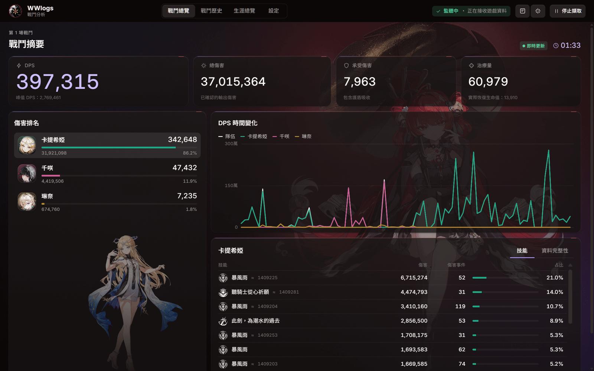
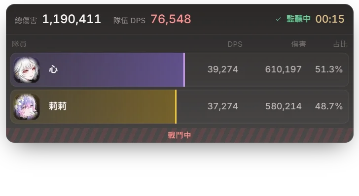
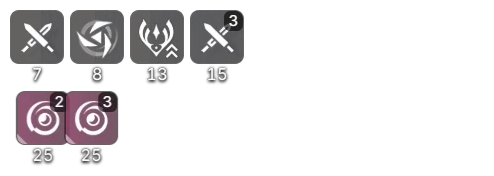
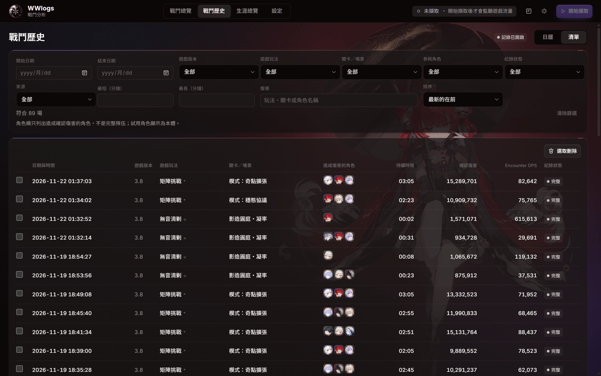
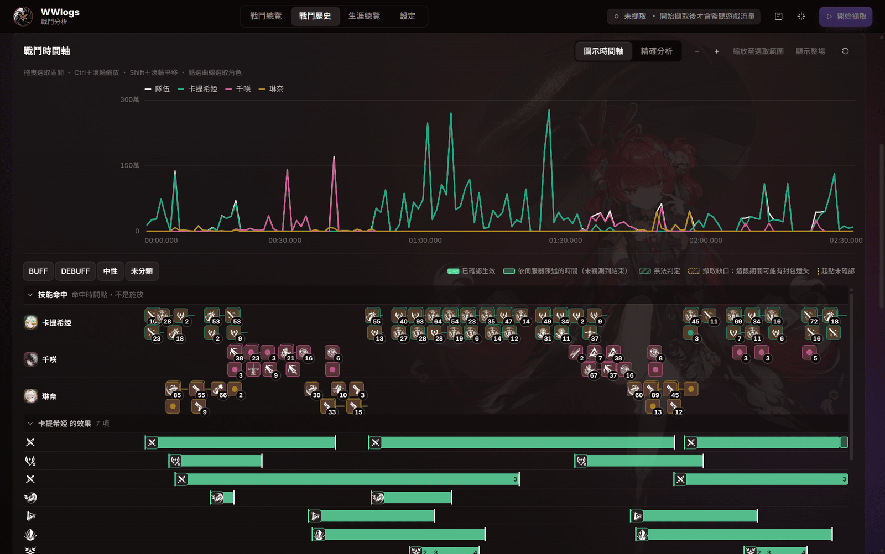
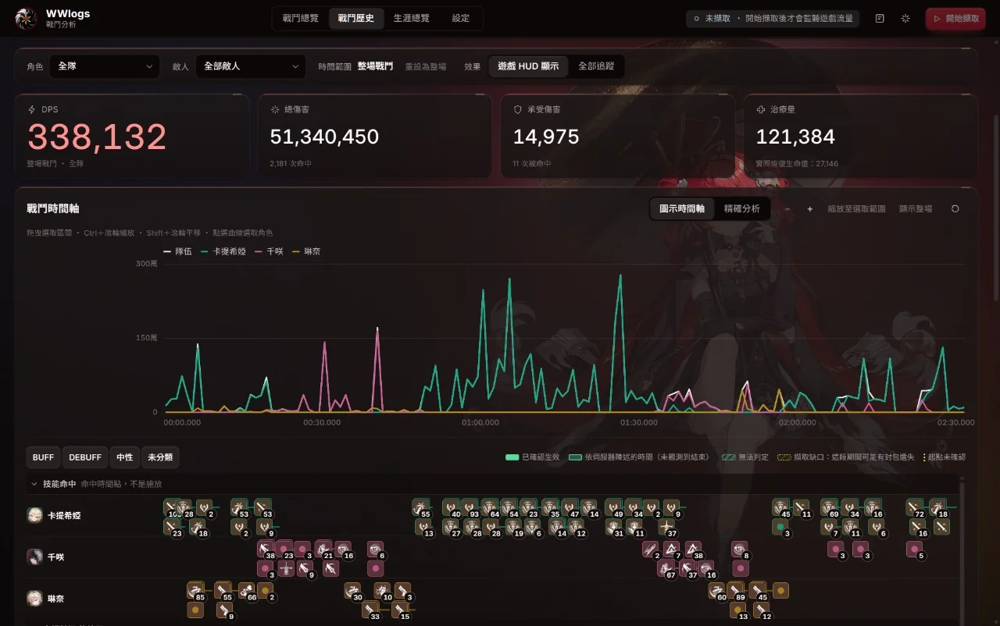
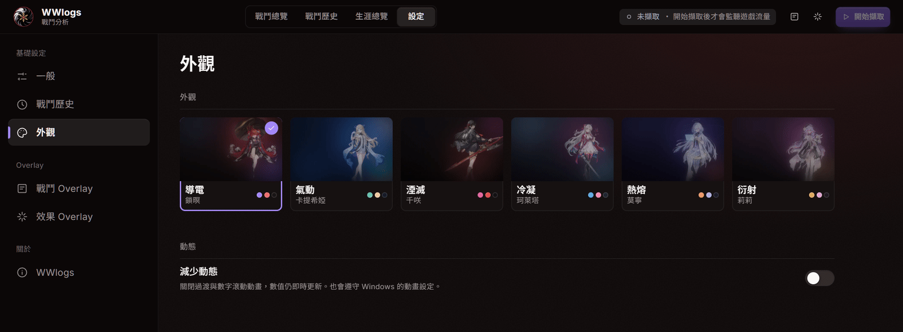

<p align="center">
  
</p>

<h1 align="center">WWlogs</h1>

<p align="center">『鳴潮』PC 版の戦闘記録・分析ツール：リアルタイム DPS、BUFF／DEBUFF の追跡、戦闘の振り返り</p>

<p align="center">
  
  <a href="LICENSE"></a>
</p>

<p align="center">
  <a href="README.md">繁體中文</a> · <a href="README.en.md">English</a> · <a href="README.ja.md">日本語</a> · <a href="README.zh-CN.md">简体中文</a> · <a href="README.ko.md">한국어</a>
</p>

WWlogs は『鳴潮』（Wuthering Waves）PC 版の戦闘分析ツールです。Windows 上で Npcap を通じてゲームのネットワーク通信を読み取り、パーティと各キャラクターの DPS、ダメージ、スキル内訳、そしてゲーム HUD 上の BUFF／DEBUFF の状態をリアルタイムに表示します。終了した戦闘はすべてお使いの PC に保存され、あとから振り返り、絞り込み、比較できます。

> [!CAUTION]
> WWlogs は非公式のサードパーティツールです。使用に伴うリスクはご自身で判断してください。使用前に[免責事項](#免責事項)と[安全な使い方](#安全な使い方)をお読みください。



## 開発のきっかけ

「鎖暝」を引くために、半年以上かけて星声を16万個貯めました。メインアタッカーにするつもりでした。ところが実際に使ってみると、BUFF の発動条件が想像以上に厳しく、強化 BUFF 中に当てないとダメージはほぼゴミ。しかも戦闘中は、ちゃんと発動したのかどうかすらよく見えません。

怒りに任せて、ちょっとだけ怒りました。それから思ったんです。自分でツールを書いて、戦闘を記録して直接分析すればいいじゃないか、と。最初はこの問題を解決したかっただけなのに、作っているうちに機能がどんどん増えて、気づけば今の WWlogs になっていました。

## 主な機能

### リアルタイム戦闘オーバーレイ

ゲーム画面の上に重ねて表示できる 2 つの小さなウィンドウです。戦闘中に画面を切り替えなくても数値を確認できます。

- **戦闘オーバーレイ**：総ダメージ、パーティ DPS、戦闘時間、そして各メンバーの DPS、ダメージ、割合、被ダメージ。メンバーはダメージの多い順に並び、順位が変わるとリアルタイムで入れ替わります。
- **効果オーバーレイ**：ゲーム HUD 上の状態を、ゲーム本来のアイコンで表示します。1 段目はバフと中立の状態、2 段目はデバフです。各アイコンには推定の残り秒数とスタック数が付き、敵に付与された状態は区別して表示されます。
- 2 つのオーバーレイはそれぞれ個別に表示／非表示を切り替えられ、常に最前面に表示、マウスクリックの透過、背景の不透明度、表示倍率を設定できます。編集モードでは、ドラッグで位置を動かし、サイズを変更できます。

<p>
  <br>
  
</p>

### ダッシュボード

- **戦闘サマリー**：DPS（1 秒ピーク DPS 付き）、総ダメージ、被ダメージ（シールドによる吸収を含む）、回復量。
- **ダメージランキング**：各キャラクターの DPS、ダメージ、割合。
- **DPS の推移**：パーティと各キャラクターの毎秒 DPS の推移を示す曲線。
- **スキル内訳**：キャラクターを選ぶと、スキルごとのダメージ、ダメージイベント数、割合を確認できます。異常状態によるダメージは分けて表示されます。
- **データ完全性**：キャプチャ中にパケットの欠落があった場合、DPS は下限値（≥）として表示されます。確実に計算できない場合は表示されません。

### 戦闘履歴

- 終了した戦闘はすべて自動で保存され、アクティビティカレンダーまたはリストで閲覧できます。
- リストは日付、ゲームバージョン、モード、ステージ／シーン、参加キャラクター、記録状態、戦闘時間で絞り込めるほか、モード、ステージ、キャラクター名で検索し、時刻、DPS、ダメージ、戦闘時間で並べ替えられます。
- 各戦闘には、ゲームバージョン、モード、ステージ／シーン、主な敵が記録されます。
- **比較**：最大 4 件の戦闘を並べて、戦闘時間、確定ダメージ、DPS、ピーク DPS、キャラクター別ダメージ、スキル別ダメージの分布を比較できます。
- 戦闘履歴は 1 件、複数件、またはすべてを削除できます。



### 戦闘ごとの分析：DPS の推移、スキル、BUFF／DEBUFF タイムライン

戦闘履歴から終了済みの戦闘を開くと、あとから詳しく分析できます。

- **戦闘タイムライン**：パーティと各キャラクターの DPS 曲線、すべてのスキルヒット、各効果の有効区間を 1 本のタイムラインに並べて表示します。拡大・縮小やスクロールもできます。
- **区間分析**：タイムライン上をドラッグして任意の区間を選ぶと、DPS、ダメージ、キャラクター順位、スキルと効果の統計がその区間の値に切り替わります。特定のキャラクターや敵だけを表示することもできます。
- **スキル**：スキルごとのダメージ、割合、ヒット数、最大単発、平均ヒット、戦闘全体での分布。
- **効果**：効果ごとの保持者、カバー率、最大スタック数、付与回数。タイムライン上の有効区間は、根拠に応じて「有効を確認」「サーバーが示した時間による」「判定不能」に分けて表示されます。
- **イベントと敵**：ダメージ、回復、効果の変化を 1 件ずつ一覧で示し、敵ごとの被ダメージ、被ヒット数、パーティに与えたダメージも表示します。





### 戦績サマリー

期間（直近 7 日、直近 30 日、全期間、カスタム）ごとに、戦闘数、確定ダメージ、戦闘時間、アクティブ日数をまとめ、自己ベスト（最高 Encounter DPS、最大確定ダメージ、最高 1 秒ピーク DPS、最大単発ダメージ）、キャラクター別の成績、同じ戦闘でダメージを与えた編成、日別の推移、モードとステージを一覧にします。自己ベストは完全な記録だけから集計されます。

### 設定・テーマ・言語

- **言語**：繁體中文、简体中文、English、日本語、한국어 から選べるほか、Windows の表示言語に合わせて自動で選ぶこともできます。キャラクター、スキル、敵、モードの名前も同じ言語で表示されます。
- **外観**：『鳴潮』のキャラクターを背景にした複数の属性テーマ。動きを減らすことができ、Windows のアニメーション設定にも従います。
- **キャプチャ**：ネットワークインターフェース、起動時のキャプチャ自動開始、戦闘情報の更新間隔。
- **戦闘履歴**：記録をオフにしたり、すべての履歴を消去したりできます。



## システム要件

| 項目 | 要件 |
| --- | --- |
| OS | Windows 64 ビット（x64）。Windows 11 で開発・テスト |
| パケットキャプチャ | [Npcap](https://npcap.com/)（別途インストールが必要） |
| 実行環境 | Microsoft Edge WebView2 Runtime（Windows 11 には標準で搭載） |

WWlogs は確認済みの現行ゲームバージョンのみに対応しています。ゲームのアップデート後にバージョン非対応の表示が出た場合は、対応する WWlogs の正式アップデートを待つか、ダウンロードしてください。

## インストールと使い方

一般のプレイヤー向けの使い方です。自分でコンパイルする必要はありません。

1. [Npcap](https://npcap.com/) をインストールします。インストール時のオプションは既定のままで構いません。
2. [Releases](https://github.com/SindouYukina/WWlogs/releases) から `WWlogs.exe` をダウンロードします。WWlogs は単一の実行ファイルで、インストールは不要です。
3. `WWlogs.exe` を開き、「設定 → 一般」でゲームの通信に使っているネットワークインターフェースを選びます。
4. **ゲームにログインする前に**、右上の「キャプチャ開始」を押します。「設定 → 一般」で「起動時にキャプチャを自動開始」をオンにすることもできます。
5. ゲームにログインして戦闘を始めます。ダッシュボードとオーバーレイはリアルタイムで更新され、終了した戦闘は自動で「戦闘履歴」に保存されます。

- 上部バー右側の 2 つのアイコンボタンで、戦闘オーバーレイと効果オーバーレイの表示／非表示を切り替えられます。オーバーレイを移動したりサイズを変えたりするには、「設定 → 戦闘オーバーレイ」または「設定 → 効果オーバーレイ」で編集モードに入ります。
- ゲームにログインしたあとでキャプチャを開始すると、WWlogs はログインを取得できなかったことを知らせます。ゲームのログイン画面に戻って再度ログインすればよく、キャプチャを止める必要はありません。
- Npcap が見つからない場合、WWlogs は画面上に Npcap 公式ダウンロードへのリンクを表示します。Npcap のインストール時に管理者だけが使えるように制限した場合は、WWlogs を管理者として実行してください。
- WWlogs は同時に 1 つしか実行されません。もう一度開くと、すでに開いているウィンドウが前面に戻ります。

## 仕組み

WWlogs は Npcap を通じてゲームクライアントとサーバーの間のネットワーク通信をキャプチャし、その中の戦闘データをお使いの PC 上で解析します。ダメージの数値には、サーバーが確定した結果を使います。WWlogs の技術的な動作と使用上の注意は、[安全な使い方](#安全な使い方)をご覧ください。

WWlogs がその接続の戦闘データを解析するには、ゲームのログインの過程を見る必要があります。そのため、キャプチャはゲームにログインする前に開始してください。

## 数値について

- **DPS（Encounter DPS）**：確定したダメージを、戦闘の開始から終了までの実際の経過時間で割った値です。アニメーション、キャラクターの切り替え、場面転換の時間も含まれます。
- **総ダメージ**：サーバーが確定したダメージだけを集計します。帰属が不明なダメージは総ダメージに含めず、画面上で別に表示します。
- **ヒット数**：スキル表が数えるのはダメージのヒットで、スキルの使用回数ではありません。WWlogs はスキルの使用を記録しません。
- **BUFF／DEBUFF**：残り秒数は推定値です。WWlogs は効果の状態と時間だけを示し、効果がどれだけダメージに寄与したかは推定せず、rDPS も計算しません。ゲームデータの多くの効果には名前がないため、効果はゲームのアイコンで表示し、分析ページでは効果 ID も併記します。
- **名前の横の「≈」**：ゲームデータから推定した名前で、その項目自体の公式名称とは限りません。「≈」にマウスを重ねると説明が表示されます。
- **数値の比較**：DPS はモード、ステージ、敵、戦闘の長さによって変わるため、条件の異なる数値はそのまま比較できません。

## データとプライバシー

- 設定と戦闘履歴は、この PC 上（`%LOCALAPPDATA%\WWlogs`）にのみ保存されます。
- WWlogs は戦闘データをアップロードせず、テレメトリや自動アップデートの機能もありません。ネットワークに接続するのは、Npcap がインストールされていないことを検出したときに、Npcap 公式サイトと GitHub で最新の Npcap インストーラーを確認する場合だけです。
- 戦闘履歴には、戦闘結果、確定したダメージと回復の結果 1 件ごと、効果の変化が保存されます。生のネットワークパケットは保存しません。

## 安全な使い方

**技術的な動作**

- WWlogs は Npcap を通じてゲームクライアントとサーバーの間のネットワーク通信をキャプチャし、キャプチャしたパケットを改変しません。
- WWlogs はゲームのメモリを読み取ったり書き換えたりせず、ゲームのプロセスに注入せず、ゲームファイルも変更しません。

これは WWlogs の技術的な設計であり、使用にアカウント上のリスクがないことや、KURO GAMES の許可を得ていることを意味するものではありません。あわせて[免責事項](#免責事項)もお読みください。

**スクリーンショット、録画、配信**

WWlogs やゲームのスクリーンショットを共有するとき、動画を録画するとき、配信するときは、画面に映るゲームの UID、プレイヤー名、そのほかあなたを特定できる情報に注意し、共有する前に画面の内容をご自身で確認してください。

## よくある質問（FAQ）

<details>
<summary>ゲームにログインする前に WWlogs のキャプチャを開始する必要がありますか？</summary>

はい。WWlogs がその接続を解析するのに必要な情報を得るには、ゲームのログインの過程を観測する必要があります。キャプチャを開始したときにすでにログインしていた場合、WWlogs はログインを取得できなかったことを知らせます。ゲームのログイン画面に戻って再度ログインすればよく、キャプチャを止める必要はありません。この手順を省きたい場合は、「設定 → 一般」で「起動時にキャプチャを自動開始」をオンにし、ゲームにログインする前に WWlogs を開いておいてください。

</details>

<details>
<summary>キャプチャを開始しても戦闘データが表示されないのはなぜですか？</summary>

次の順に確認してください。

1. Npcap がインストールされていること。WWlogs は Npcap が見つからない場合、画面上で知らせます。
2. 「設定 → 一般」で、ゲームの通信に実際に使われているネットワークインターフェースが選ばれていること。
3. ゲームにログインする前にキャプチャを開始したこと。ログインを取得できなかった場合は、ログイン画面に戻って再度ログインしてください。
4. 現在のゲームバージョンに、このバージョンの WWlogs が対応していること。対応していない場合は「このゲームバージョンはまだサポートされていません。WWlogs を更新してください」と表示されます。

上部バーの状態表示（例：「ゲーム待機中」「監視中」）でも、WWlogs の現在の状況を確認できます。

</details>

<details>
<summary>WWlogs はゲームのメモリを読み取ったり書き換えたりしますか？</summary>

いいえ。WWlogs は Npcap を通じてゲームクライアントとサーバーの間のネットワーク通信をキャプチャし、その中の戦闘データをお使いの PC 上で解析するだけです。ゲームのメモリを読み取ったり書き換えたりせず、いかなるプログラムも注入せず、ゲームファイルも変更しません。詳しくは[安全な使い方](#安全な使い方)をご覧ください。

</details>

<details>
<summary>WWlogs を使うと BAN されるリスクはありますか？</summary>

WWlogs は非公式のサードパーティツールであり、KURO GAMES の許諾、承認、支持を受けていません。[安全な使い方](#安全な使い方)で説明している技術的な設計は、リスクがゼロであることを意味せず、WWlogs は使用によってアカウントに影響が出ないことを保証できません。使用するかどうかは、ゲームの規約をご自身で確認し、リスクを判断したうえで決めてください。詳しくは[免責事項](#免責事項)をご覧ください。

</details>

<details>
<summary>一部の BUFF／DEBUFF に名前がなかったり、残り時間が不正確だったりするのはなぜですか？</summary>

ゲームデータの多くの効果には、使える公式名称がありません。効果オーバーレイではゲームのアイコンだけを表示し、分析ページではそうした効果を「未識別の効果」と効果 ID で示し、独自に名前を付けることはしません。効果オーバーレイの残り秒数は推定値です。分析ページの有効区間は、根拠に応じて「有効を確認」「サーバーが示した時間による」「判定不能」に分けて表示され、WWlogs が推定した結果を検証済みの事実として扱うことはありません。

</details>

<details>
<summary>WWlogs は私の戦闘データをアップロードしますか？</summary>

いいえ。戦闘分析と戦闘履歴はお使いの PC に保存され、WWlogs は戦闘記録をアップロードせず、テレメトリやクラウドアカウントの同期もありません。WWlogs 自体がネットワークに接続するのは 1 つの場合だけです。Npcap がインストールされていないことを検出したときに、Npcap 公式サイトと GitHub で最新の Npcap インストーラーを確認します。

</details>

<details>
<summary>ゲームのアップデート後に解析できなくなったらどうすればよいですか？</summary>

WWlogs は現在確認済みのゲームバージョンのみに対応しており、ほかのバージョンとの互換性は保証しません。ゲームのアップデート後に「このゲームバージョンはまだサポートされていません。WWlogs を更新してください」と表示された場合は、新しいゲームバージョンに対応した WWlogs の正式アップデートをお待ちください。

</details>

<details>
<summary>PS5、Linux、macOS には対応していますか？</summary>

現在対応しているのは Windows PC 版だけです。PS5、Linux、macOS 版やリモートキャプチャ版の WWlogs はなく、今後提供することも約束していません。

</details>

<details>
<summary>WWlogs を自分でビルドできますか？</summary>

はい。WWlogs のソースコードは AGPL-3.0-only ライセンスで公開されており、ライセンスの条件に従って使用、改変、頒布できます。ビルド方法は[開発とビルド](#開発とビルド)をご覧ください。ビルドに必要な外部鍵はご自身で用意する必要があります。本プロジェクトは鍵を提供せず、入手方法の提供や議論も行いません。

</details>

<details>
<summary>WWlogs で戦闘ログをエクスポートできますか？</summary>

できません。これは技術的な制約ではなく、意図した製品設計です。WWlogs の目的は、自分の戦闘を分析し、スキルや BUFF／DEBUFF を理解して、自分の立ち回りを改善する手助けをすることです。WWlogs は DPS を軸にしたプレイヤー同士の競争（PVP）に反対しています。そのため、WWlogs の公式版は次のものを提供しません。

- 生の戦闘ログのエクスポート
- 戦闘記録を再構築または交換できる CSV、JSON などの平文データのエクスポート
- 公開の DPS ランキング
- プレイヤー間で戦闘記録を比較する公式サービス

WWlogs が勧めるのは、ほかのプレイヤーと数値を競うことではなく、自分自身と比べて上達し続けることです。

</details>

<details>
<summary>PC を変えたあと、元の戦闘履歴を引き継げますか？</summary>

できません。戦闘履歴は、記録を作成した PC 上でのみ使用できます。新しい PC では、元の記録ファイルをコピーしても直接読み込むことはできません。WWlogs の公式版には、PC 間で戦闘履歴を移行、復元、引き継ぐ機能はなく、新しい PC の戦闘履歴は最初から蓄積されます。これは、個人の分析に重点を置き、DPS 競争に反対する WWlogs の方針に沿ったものです。

</details>

## 開発とビルド

一般のプレイヤーは[インストールと使い方](#インストールと使い方)に従って正式版をダウンロードしてください。自分でコンパイルする必要はありません。このセクションは、ソースコードから WWlogs をビルドしたい開発者向けです。

**必要な環境**

- Windows x64 と PowerShell 7（`pwsh`）。
- Go：`go.mod` で指定されたバージョン以上（現在は 1.27.4）。ビルドスクリプトは `GOTOOLCHAIN=local` を設定するため、システムにインストールされた Go だけを使い、ほかのバージョンを自動でダウンロードすることはありません。
- Node.js と npm：`frontend/package.json` の `engines` に合うバージョン（現在は Node.js `>=26.13.1 <27`、npm `>=12.2.2 <13`）。フロントエンドの依存関係は `frontend/package-lock.json` に従ってインストールされます。
- 外部鍵（下記を参照）。

**外部鍵**

ビルドには外部鍵が 1 つ必要です。2048 ビット、PKCS#1 形式の RSA 秘密鍵の PEM ファイルを `.local/keys/privateKey.pem` に置きます（`.local/` は Git の管理対象外です）。このファイルがない場合、ビルドはその場で停止します。鍵は開発者自身で用意する必要があります。WWlogs は鍵を一切提供せず、入手方法の提供や議論も行いません。

**ビルド**

```powershell
git clone https://github.com/SindouYukina/WWlogs.git
cd WWlogs
pwsh -File scripts/build.ps1 -Profile Public
```

- 完成した実行ファイルは `bin\public\WWlogs.exe` です。`-Profile Development` は診断とリプレイの機能を含む開発版（`bin\development\WWlogs.exe`）をビルドします。これは開発と研究専用で、外部に配布するのは常に Public 版です。`-Profile Both` は両方を一度にビルドします。
- ソースコードからビルドした実行ファイルは非公式ビルド（Unofficial）と表示されます。正式なビルド番号は、プロジェクトオーナーのビルド環境だけが発行します。自分でビルドした実行ファイルが正式リリース版とバイト単位で一致することは保証されません。
- ビルドの流れ、ビルド番号、そのほかのオプションの詳細は、[build/windows/README.md](build/windows/README.md) をご覧ください。

## 謝辞

WWlogs の設計の多くは、以下のプロジェクトから着想を得ています。ここに感謝を申し上げます。これらのプロジェクトと WWlogs の間に提携、後援、承認の関係はありません。WWlogs が参考にしたのはそれらの設計と考え方であり、コードやデータは使用していません。

### 主なインスピレーション

- **[FF Logs](https://www.fflogs.com/) と [xivanalysis](https://xivanalysis.com/)**：戦闘記録を深く分析するという考え方。1 回ごとの戦闘の振り返り、スキルイベントと戦闘タイムラインによる戦闘の表現、BUFF／DEBUFF のカバー率の分析、そして戦闘データを通じて自分の立ち回りを理解し改善することを含みます。WWlogs が参考にしたのはその分析の深さと情報の見せ方であり、公開ランキングやプレイヤー同士の競争の仕組みではありません。
- **[ZMDLogs](https://github.com/deepdarkssj/ZMDLogs)**：パケットキャプチャ、プロトコル解析、データ表示を層に分けて扱う設計と、リアルタイムのダメージオーバーレイおよび BUFF／DEBUFF オーバーレイの情報構成。ZMDLogs は別のゲームを解析するツールで、両者のプロトコルに互換性はありません。
- **[A2Tools DPS Meter](https://github.com/taengu/A2Tools-DPS-Meter)**：DPS ダッシュボードの情報構成、ダメージ数値の見せ方、ダメージバーとそのアニメーション。

### デザインと研究の参考

- **[AionMeter](https://tmopcode.github.io/AionMeter/)／[AionFlex](https://aionflex.gg/)**：オーバーレイの外観と情報の見せ方、効果の終了が近いときの通知、オーバーレイ設定項目の構成。
- **[Iridium-Ww](https://github.com/WutheringWavesGame/Iridium-Ww)**：初期の UDP／KCP プロトコル研究と、キャプチャ、フレーム分割、解析を層に分ける考え方。これは比較的初期の、歴史的な研究資料で、そのプロトコルデータは現在のゲームバージョンには当てはまりません。
- **[Kokonut UI](https://kokonutui.com/)／[easeUI](https://easeui.dev/)**：セグメントコントロール（Segmented Control）の移動するインジケーターとインタラクションの動き、短いトランジションとレイアウト計算の方法についての設計上の参考。

WWlogs が実際に使用しているサードパーティライブラリ、フォント、およびプロジェクトにコピーしたコード（shadcn/ui のコンポーネントなど）の著作権とライセンスは [THIRD_PARTY_NOTICES.md](THIRD_PARTY_NOTICES.md) に記載しており、アプリの「設定 → ライセンス」でも確認できます。

## 免責事項

- WWlogs は独立して開発された非公式のサードパーティツールであり、KURO GAMES を代表するものではありません。また、KURO GAMES の許諾、承認、提携、後援、支持を受けていると主張するものでもありません。『鳴潮』関連素材の権利の帰属については、[ライセンスと表記](#ライセンスと表記)をご覧ください。
- サードパーティツールの使用にはリスクが伴う可能性があり、WWlogs はアカウントに影響が出ないことを保証できません。使用する前に、ゲームの規約をご自身で確認し、リスクを判断してください。
- WWlogs は AGPL-3.0-only ライセンスの条件に基づき、適用法で認められる範囲において「現状のまま」提供され、明示または黙示を問わず、いかなる保証もありません。無保証と責任の制限に関する条項の全文は、[LICENSE](LICENSE) の第 15 条と第 16 条をご覧ください。

## ライセンスと表記

Copyright (C) 2026 SindouYukina

WWlogs はフリーソフトウェアです。フリーソフトウェア財団が公表した GNU Affero General Public License v3.0 only（SPDX：`AGPL-3.0-only`）の条件に従って、本プログラムを再頒布または改変することができます。WWlogs は有用であることを願って頒布されますが、全くの無保証です。商品性の保証や特定目的への適合性は、黙示的なものも含め、一切ありません。ライセンスの全文は [LICENSE](LICENSE) をご覧ください。

上記の著作権表示と AGPL-3.0-only ライセンスは、WWlogs 独自のソースコードにのみ適用されます。『鳴潮』のゲーム素材、内蔵フォント、サードパーティライブラリは、それぞれの権利とライセンスに基づいて提供されます。詳しくは [THIRD_PARTY_NOTICES.md](THIRD_PARTY_NOTICES.md) をご覧ください。

『鳴潮』（Wuthering Waves）のゲームアートおよび知的財産権は、KURO GAMES またはそれぞれの正当な権利者に帰属します。これには、WWlogs およびこのページのスクリーンショットに含まれるキャラクター画像、スキルアイコン、効果アイコン、テーマ背景および関連する派生デザインが含まれます。これらの素材は WWlogs 独自のソースコードには含まれず、その AGPL-3.0-only ライセンスの対象外です。

WWlogs は独立して開発された非公式ツールであり、KURO GAMES を代表するものではありません。公式の提携、後援、承認を受けていると主張するものでもありません。『鳴潮』公式サイト：<https://wutheringwaves.kurogames.com/>
