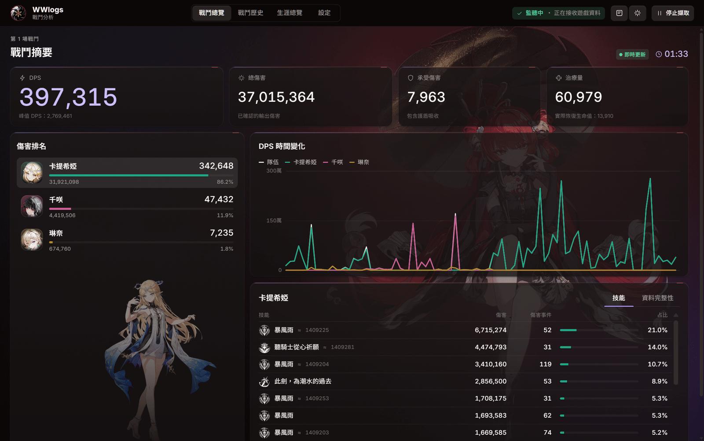
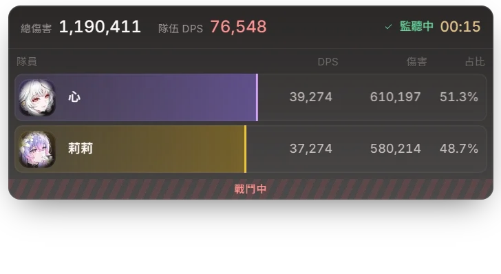
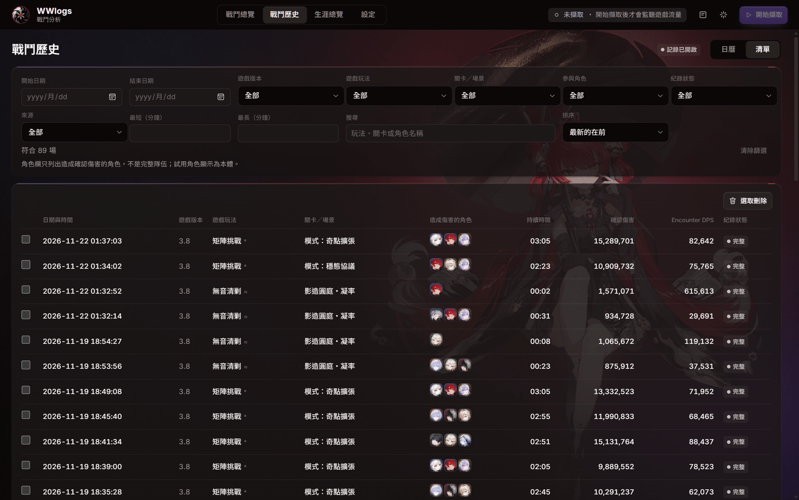
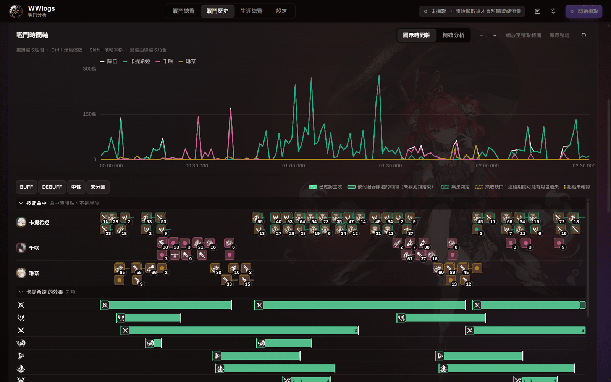
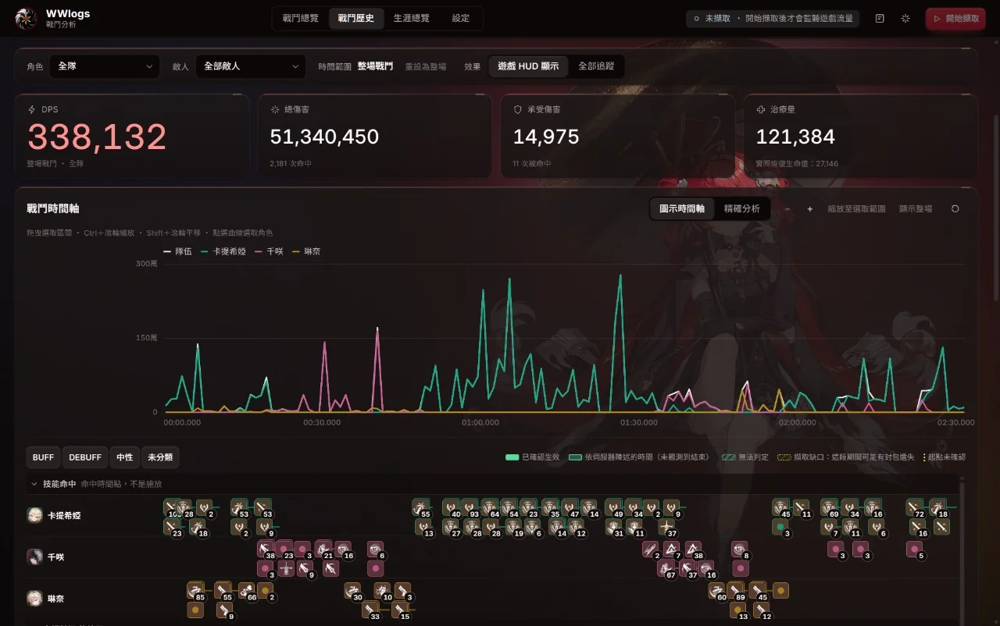
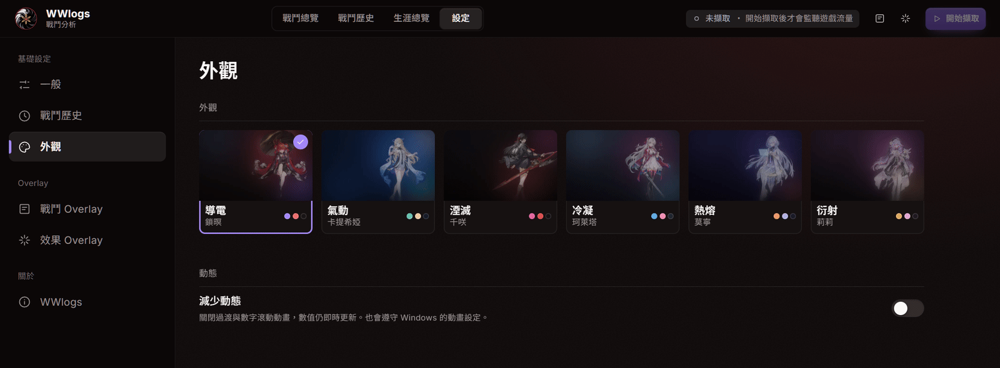

<p align="center">
  
</p>

<h1 align="center">WWlogs</h1>

<p align="center">《명조: 워더링 웨이브》 PC 버전용 전투 기록·분석 도구: 실시간 DPS, BUFF/DEBUFF 추적, 전투 되돌아보기</p>

<p align="center">
  
  <a href="LICENSE"></a>
</p>

<p align="center">
  <a href="README.md">繁體中文</a> · <a href="README.en.md">English</a> · <a href="README.ja.md">日本語</a> · <a href="README.zh-CN.md">简体中文</a> · <a href="README.ko.md">한국어</a>
</p>

WWlogs는 《명조: 워더링 웨이브》(Wuthering Waves) PC 버전용 전투 분석 도구입니다. Windows에서 Npcap을 통해 게임의 네트워크 통신을 읽고, 파티와 각 캐릭터의 DPS, 피해량, 스킬 세부 내역, 그리고 게임 HUD에 표시되는 BUFF/DEBUFF 상태를 실시간으로 보여 줍니다. 끝난 전투는 모두 PC에 저장되므로 나중에 다시 보고, 필터링하고, 비교할 수 있습니다.

> [!CAUTION]
> WWlogs는 비공식 서드파티 도구이며, 사용에 따른 위험은 스스로 판단해야 합니다. 사용하기 전에 [면책 조항](#면책-조항)과 [안전한 사용](#안전한-사용)을 읽어 주세요.



## 개발 계기

‘쇄명’을 뽑으려고 반년 넘게 별의 소리를 16만 개나 모았다. 메인 딜러로 쓸 생각이었다. 그런데 막상 써 보니 BUFF 발동 조건이 생각보다 훨씬 까다로웠고, 강화 BUFF 안에서 때리지 않으면 그냥 쓰레기 딜이었다. 게다가 전투 중에는 BUFF가 제대로 발동했는지조차 알아보기 어려웠다.

홧김에 살짝 화를 내 봤다. 그러고는 생각했다. 직접 도구를 만들어서 전투를 기록하고 바로 분석하면 되지 않을까? 처음에는 이 문제 하나만 해결하려고 했는데, 만들다 보니 기능이 점점 늘어나서 결국 지금의 WWlogs가 되었다.

## 주요 기능

### 실시간 전투 오버레이

게임 화면 위에 겹쳐 띄울 수 있는 작은 창 두 개로, 전투 중에 화면을 전환하지 않고도 수치를 볼 수 있습니다.

- **전투 오버레이**: 총 피해량, 파티 DPS, 전투 시간, 그리고 파티원별 DPS, 피해량, 비율, 받은 피해. 파티원은 피해량 순으로 정렬되며, 순위가 바뀌면 실시간으로 자리를 바꿉니다.
- **효과 오버레이**: 게임 HUD의 상태를 게임 자체 아이콘으로 보여 줍니다. 첫째 줄은 버프와 중립 상태, 둘째 줄은 디버프이며, 아이콘마다 추정 남은 시간(초)과 중첩 수가 표시되고, 적에게 부여된 상태는 따로 표시됩니다.
- 두 오버레이는 각각 따로 켜고 끌 수 있으며, 항상 위에 표시, 마우스 클릭 통과, 배경 불투명도, 표시 배율을 설정할 수 있습니다. 편집 모드에서는 드래그해서 위치를 옮기고 크기를 조절합니다.

<p>
  <br>
  
</p>

### 대시보드

- **전투 요약**: DPS(1초 피크 DPS 포함), 총 피해량, 받은 피해(보호막 흡수 포함), 치유량.
- **피해량 순위**: 캐릭터별 DPS, 피해량, 비율.
- **시간별 DPS**: 파티와 각 캐릭터의 초당 DPS 변화 곡선.
- **스킬 세부 내역**: 캐릭터를 선택하면 스킬별 피해량, 피해 이벤트 수, 비율을 볼 수 있으며, 이상 상태로 인한 피해는 따로 표시됩니다.
- **데이터 완전성**: 캡처 중 패킷 손실이 있으면 DPS는 하한값(≥)으로 표시되고, 신뢰할 수 있게 계산할 수 없으면 표시되지 않습니다.

### 전투 기록

- 끝난 전투는 모두 자동으로 저장되며, 활동 캘린더나 목록으로 살펴볼 수 있습니다.
- 목록은 날짜, 게임 버전, 모드, 스테이지 또는 장소, 참여 캐릭터, 기록 상태, 전투 시간으로 필터링할 수 있고, 모드·스테이지·캐릭터 이름으로 검색하거나 시간, DPS, 피해량, 전투 시간순으로 정렬할 수 있습니다.
- 각 전투에는 게임 버전, 모드, 스테이지 또는 장소, 주요 적이 기록됩니다.
- **비교**: 최대 4개의 전투를 나란히 놓고 전투 시간, 확정 피해, DPS, 피크 DPS, 캐릭터별 피해량, 스킬별 피해 분포를 비교할 수 있습니다.
- 전투 기록은 하나, 여러 개 또는 전체를 삭제할 수 있습니다.



### 전투별 분석: DPS 추이, 스킬, BUFF/DEBUFF 타임라인

전투 기록에서 끝난 전투를 열면 사후 분석을 할 수 있습니다.

- **전투 타임라인**: 파티와 각 캐릭터의 DPS 곡선, 모든 스킬 적중, 각 효과의 적용 구간을 하나의 타임라인에 나란히 보여 주며, 확대·축소와 이동이 가능합니다.
- **구간 분석**: 타임라인에서 드래그해 원하는 구간을 선택하면 DPS, 피해량, 캐릭터 순위, 스킬과 효과 통계가 그 구간의 값으로 바뀝니다. 특정 캐릭터나 적만 볼 수도 있습니다.
- **스킬**: 스킬별 피해량, 비율, 적중 횟수, 최대 단일 피해, 평균 적중, 전투 전체의 분포.
- **효과**: 효과별 보유자, 유지율, 최대 중첩 수, 부여 횟수. 타임라인의 적용 구간은 근거에 따라 ‘적용 확인’, ‘서버가 제시한 시간 기준’, ‘판정 불가’로 구분해 표시합니다.
- **이벤트와 적**: 피해, 치유, 효과 변화를 한 건씩 나열하고, 적별로 받은 피해, 적중당한 횟수, 파티에 준 피해를 보여 줍니다.





### 전적 요약

기간(최근 7일, 최근 30일, 전체, 사용자 지정)별로 전투 수, 확정 피해, 전투 시간, 활동 일수를 정리하고, 개인 기록(최고 Encounter DPS, 최대 확정 피해, 최고 1초 피크 DPS, 최대 단일 피해), 캐릭터별 성적, 같은 전투에서 피해를 준 조합, 일별 추이, 모드와 스테이지를 보여 줍니다. 개인 기록은 완전한 기록에서만 집계합니다.

### 설정, 테마, 언어

- **언어**: 繁體中文, 简体中文, English, 日本語, 한국어 중에서 고를 수 있고, Windows 표시 언어에 맞춰 자동으로 선택할 수도 있습니다. 캐릭터, 스킬, 적, 모드 이름도 같은 언어로 표시됩니다.
- **외관**: 《명조: 워더링 웨이브》 캐릭터를 배경으로 한 여러 속성 테마. 동작을 줄일 수 있으며, Windows의 애니메이션 설정도 따릅니다.
- **캡처**: 네트워크 인터페이스, 실행 시 자동 캡처 시작, 전투 정보 업데이트 간격.
- **전투 기록**: 기록을 끄거나 전체 기록을 지울 수 있습니다.



## 시스템 요구 사항

| 항목 | 요구 사항 |
| --- | --- |
| 운영 체제 | Windows 64비트(x64), Windows 11에서 개발 및 테스트 |
| 패킷 캡처 | [Npcap](https://npcap.com/), 별도 설치 필요 |
| 실행 환경 | Microsoft Edge WebView2 Runtime(Windows 11에 기본 포함) |

WWlogs는 확인된 현행 게임 버전만 지원합니다. 게임 업데이트 후 버전을 지원하지 않는다는 안내가 나타나면, 해당하는 WWlogs 정식 업데이트를 기다리거나 다운로드하세요.

## 설치 및 사용

일반 플레이어를 위한 사용 방법이며, 직접 컴파일할 필요는 없습니다.

1. [Npcap](https://npcap.com/)을 설치합니다. 설치 옵션은 기본값 그대로 두면 됩니다.
2. [Releases](https://github.com/SindouYukina/WWlogs/releases)에서 `WWlogs.exe`를 다운로드합니다. WWlogs는 단일 실행 파일이라 설치할 필요가 없습니다.
3. `WWlogs.exe`를 열고 ‘설정 → 일반’에서 게임 연결에 사용하는 네트워크 인터페이스를 선택합니다.
4. **게임에 로그인하기 전에** 오른쪽 위의 ‘캡처 시작’을 누릅니다. ‘설정 → 일반’에서 ‘실행 시 자동으로 캡처 시작’을 켜 둘 수도 있습니다.
5. 게임에 로그인해 전투를 시작합니다. 대시보드와 오버레이가 실시간으로 갱신되고, 끝난 전투는 자동으로 ‘전투 기록’에 저장됩니다.

- 상단 바 오른쪽의 아이콘 버튼 두 개로 전투 오버레이와 효과 오버레이를 표시하거나 숨길 수 있습니다. 오버레이를 옮기거나 크기를 조절하려면 ‘설정 → 전투 오버레이’ 또는 ‘설정 → 효과 오버레이’에서 편집 모드로 들어가세요.
- 게임에 로그인한 뒤에 캡처를 시작하면 WWlogs가 로그인을 놓쳤다고 알려 줍니다. 게임의 로그인 화면으로 돌아가 다시 로그인하면 되며, 캡처를 멈출 필요는 없습니다.
- WWlogs가 Npcap을 찾지 못하면 화면에 Npcap 공식 다운로드 링크를 보여 줍니다. Npcap을 설치할 때 관리자만 사용하도록 제한했다면 WWlogs를 관리자 권한으로 실행하세요.
- WWlogs는 한 번에 하나만 실행됩니다. 다시 실행하면 이미 열려 있는 창을 앞으로 가져옵니다.

## 작동 방식

WWlogs는 Npcap을 통해 게임 클라이언트와 서버 사이의 네트워크 통신을 캡처하고, 그 안의 전투 데이터를 사용자의 PC에서 분석합니다. 피해 수치는 서버가 확정한 결과를 사용합니다. WWlogs의 기술적 동작과 사용 시 주의 사항은 [안전한 사용](#안전한-사용)을 참고하세요.

WWlogs가 해당 연결의 전투 데이터를 분석하려면 게임의 로그인 과정을 봐야 합니다. 그러므로 게임에 로그인하기 전에 캡처를 시작하세요.

## 수치 설명

- **DPS(Encounter DPS)**: 확정된 피해를 전투 시작부터 종료까지 실제로 흐른 시간으로 나눈 값입니다. 애니메이션, 캐릭터 교체, 전환 시간도 포함됩니다.
- **총 피해량**: 서버가 확정한 피해만 집계합니다. 귀속을 알 수 없는 피해는 총 피해량에 포함하지 않고 화면에 따로 표시합니다.
- **적중 횟수**: 스킬 표가 세는 것은 피해 적중이며, 스킬 사용 횟수가 아닙니다. WWlogs는 스킬 사용을 기록하지 않습니다.
- **BUFF/DEBUFF**: 남은 시간(초)은 추정값입니다. WWlogs는 효과의 상태와 시간만 보여 주며, 효과가 피해에 얼마나 기여했는지는 추정하지 않고 rDPS도 계산하지 않습니다. 게임 데이터의 효과 대부분은 이름이 없어서 효과는 게임 아이콘으로 표시하고, 분석 페이지에는 효과 ID도 함께 표시합니다.
- **이름 옆의 ‘≈’**: 게임 데이터를 바탕으로 추정한 이름이며, 그 항목 자체의 공식 이름이 아닐 수 있습니다. ‘≈’ 위에 마우스를 올리면 설명을 볼 수 있습니다.
- **수치 비교**: DPS는 모드, 스테이지, 적, 전투 길이에 따라 달라지므로 조건이 다른 수치는 그대로 비교할 수 없습니다.

## 데이터와 개인정보

- 설정과 전투 기록은 이 PC(`%LOCALAPPDATA%\WWlogs`)에만 저장됩니다.
- WWlogs는 전투 데이터를 업로드하지 않으며, 원격 측정이나 자동 업데이트 기능도 없습니다. Npcap이 설치되어 있지 않은 것을 감지했을 때에만 Npcap 공식 웹사이트와 GitHub에 접속해 최신 Npcap 설치 프로그램을 확인합니다.
- 전투 기록에는 전투 결과, 확정된 피해와 치유 결과 하나하나, 효과 변화가 저장되며, 원본 네트워크 패킷은 저장하지 않습니다.

## 안전한 사용

**기술적 동작**

- WWlogs는 Npcap을 통해 게임 클라이언트와 서버 사이의 네트워크 통신을 캡처하며, 캡처한 네트워크 패킷을 수정하지 않습니다.
- WWlogs는 게임 메모리를 읽거나 수정하지 않고, 게임 프로세스에 주입하지 않으며, 게임 파일도 수정하지 않습니다.

이는 WWlogs의 기술적 설계일 뿐이며, 사용에 계정 위험이 없다거나 KURO GAMES의 허가를 받았다는 뜻은 아닙니다. [면책 조항](#면책-조항)도 함께 읽어 주세요.

**스크린샷, 녹화, 방송**

WWlogs나 게임의 스크린샷을 공유하거나, 영상을 녹화하거나, 방송할 때는 화면에 보이는 게임 UID, 플레이어 이름, 그 밖에 본인을 식별할 수 있는 정보에 주의하고, 공유하기 전에 화면 내용을 직접 확인하세요.

## 자주 묻는 질문(FAQ)

<details>
<summary>게임에 로그인하기 전에 WWlogs 캡처를 시작해야 하나요?</summary>

네. WWlogs가 해당 연결을 분석하는 데 필요한 정보를 얻으려면 게임의 로그인 과정을 관찰해야 합니다. 캡처를 시작할 때 이미 로그인되어 있었다면 WWlogs가 로그인을 놓쳤다고 알려 줍니다. 게임의 로그인 화면으로 돌아가 다시 로그인하면 되며, 캡처를 멈출 필요는 없습니다. 이 과정을 생략하고 싶다면 ‘설정 → 일반’에서 ‘실행 시 자동으로 캡처 시작’을 켜고, 게임에 로그인하기 전에 WWlogs를 먼저 실행해 두세요.

</details>

<details>
<summary>캡처를 시작했는데 왜 전투 데이터가 없나요?</summary>

다음을 순서대로 확인하세요.

1. Npcap이 설치되어 있어야 합니다. WWlogs는 Npcap을 찾지 못하면 화면에 알려 줍니다.
2. ‘설정 → 일반’에서 게임 연결에 실제로 사용하는 네트워크 인터페이스를 선택해야 합니다.
3. 캡처는 게임에 로그인하기 전에 시작해야 합니다. 로그인을 놓쳤다면 로그인 화면으로 돌아가 다시 로그인하세요.
4. 현재 게임 버전을 이 버전의 WWlogs가 지원해야 합니다. 지원하지 않으면 화면에 ‘이 게임 버전은 아직 지원되지 않습니다. WWlogs를 업데이트하세요’가 표시됩니다.

상단 바의 수신 상태(예: ‘게임 대기 중’, ‘수신 중’)에서도 WWlogs의 현재 상황을 볼 수 있습니다.

</details>

<details>
<summary>WWlogs가 게임 메모리를 읽거나 수정하나요?</summary>

아니요. WWlogs는 Npcap을 통해 게임 클라이언트와 서버 사이의 네트워크 통신을 캡처하고 그 안의 전투 데이터를 사용자의 PC에서 분석할 뿐입니다. 게임 메모리를 읽거나 수정하지 않고, 어떤 프로그램도 주입하지 않으며, 게임 파일도 수정하지 않습니다. 자세한 내용은 [안전한 사용](#안전한-사용)을 참고하세요.

</details>

<details>
<summary>WWlogs를 사용하면 계정 정지 위험이 있나요?</summary>

WWlogs는 비공식 서드파티 도구이며, KURO GAMES의 허가, 인정, 보증을 받지 않았습니다. [안전한 사용](#안전한-사용)에서 설명한 기술적 설계가 위험이 전혀 없다는 뜻은 아니며, WWlogs는 사용 후 계정에 영향이 없다고 보장할 수 없습니다. 사용 여부는 게임의 관련 규정을 직접 확인하고 위험을 판단한 뒤 결정하세요. 자세한 내용은 [면책 조항](#면책-조항)을 참고하세요.

</details>

<details>
<summary>일부 BUFF/DEBUFF에 이름이 없거나 남은 시간이 정확하지 않은 이유는 무엇인가요?</summary>

게임 데이터의 효과 대부분에는 사용할 수 있는 공식 이름이 없습니다. 효과 오버레이는 게임 아이콘만 보여 주고, 분석 페이지는 이런 효과를 ‘미확인 효과’와 효과 ID로 표시하며 임의로 이름을 붙이지 않습니다. 효과 오버레이의 남은 시간(초)은 추정값입니다. 분석 페이지의 적용 구간은 근거에 따라 ‘적용 확인’, ‘서버가 제시한 시간 기준’, ‘판정 불가’로 구분해 표시하며, WWlogs는 추정한 결과를 검증된 사실로 취급하지 않습니다.

</details>

<details>
<summary>WWlogs가 내 전투 데이터를 업로드하나요?</summary>

아니요. 전투 분석과 전투 기록은 모두 사용자의 PC에 저장되며, WWlogs는 전투 기록을 업로드하지 않고 원격 측정이나 클라우드 계정 동기화도 없습니다. WWlogs 자체가 네트워크에 접속하는 경우는 한 가지뿐입니다. Npcap이 설치되어 있지 않은 것을 감지하면 Npcap 공식 웹사이트와 GitHub에서 최신 Npcap 설치 프로그램을 확인합니다.

</details>

<details>
<summary>게임 업데이트 후 분석이 안 되면 어떻게 하나요?</summary>

WWlogs는 현재 확인된 게임 버전만 지원하며, 다른 버전과의 호환성은 보장하지 않습니다. 게임 업데이트 후 ‘이 게임 버전은 아직 지원되지 않습니다. WWlogs를 업데이트하세요’라고 표시되면, 새 게임 버전을 지원하는 WWlogs 정식 업데이트를 기다려 주세요.

</details>

<details>
<summary>PS5, Linux, macOS를 지원하나요?</summary>

현재는 Windows PC 버전만 지원합니다. PS5, Linux, macOS 버전이나 원격 캡처 버전의 WWlogs는 없으며, 앞으로 출시하겠다고 약속하지도 않습니다.

</details>

<details>
<summary>WWlogs를 직접 빌드할 수 있나요?</summary>

네. WWlogs의 소스 코드는 AGPL-3.0-only 라이선스로 공개되어 있으며, 라이선스 조건에 따라 사용, 수정, 배포할 수 있습니다. 빌드 방법은 [개발 및 빌드](#개발-및-빌드)를 참고하세요. 빌드에 필요한 외부 키는 직접 준비해야 하며, 이 프로젝트는 키를 제공하지 않고 입수 방법을 제공하거나 논의하지도 않습니다.

</details>

<details>
<summary>WWlogs로 전투 로그를 내보낼 수 있나요?</summary>

아니요. 이는 기술적 한계가 아니라 의도된 제품 설계입니다. WWlogs의 목적은 자신의 전투를 분석하고, 스킬과 BUFF/DEBUFF를 이해하고, 자신의 플레이를 개선하도록 돕는 것입니다. WWlogs는 DPS를 중심으로 한 플레이어 간 경쟁(PVP)에 반대합니다. 그래서 WWlogs 공식 버전은 다음을 제공하지 않습니다.

- 원본 전투 로그 내보내기
- 전투 기록을 재구성하거나 교환할 수 있는 CSV, JSON 등 평문 데이터 내보내기
- 공개 DPS 순위표
- 플레이어 간 전투 기록을 비교하는 공식 서비스

WWlogs가 권하는 것은 다른 플레이어와 수치로 경쟁하는 것이 아니라, 자기 자신과 비교하며 꾸준히 발전하는 것입니다.

</details>

<details>
<summary>PC를 바꾼 뒤에도 기존 전투 기록을 이어서 쓸 수 있나요?</summary>

아니요. 전투 기록은 기록을 만든 PC에서만 로컬로 사용할 수 있습니다. 새 PC로 원래 기록 파일을 복사하더라도 새 PC에서 바로 읽을 수 없습니다. WWlogs 공식 버전은 PC 간 전투 기록의 이전, 복원, 승계 기능을 제공하지 않으며, 새 PC의 전투 기록은 처음부터 다시 쌓입니다. 이는 개인 분석에 집중하고 DPS 경쟁에 반대하는 WWlogs의 방향과 일치합니다.

</details>

## 개발 및 빌드

일반 플레이어는 [설치 및 사용](#설치-및-사용)에 따라 정식 버전을 다운로드하면 되며, 직접 컴파일할 필요는 없습니다. 이 섹션은 소스 코드에서 WWlogs를 빌드하려는 개발자를 위한 내용입니다.

**필요한 환경**

- Windows x64와 PowerShell 7(`pwsh`).
- Go: `go.mod`에 지정된 버전 이상(현재 1.27.4). 빌드 스크립트는 `GOTOOLCHAIN=local`을 설정하므로 시스템에 설치된 Go만 사용하며, 다른 버전을 자동으로 다운로드하지 않습니다.
- Node.js와 npm: `frontend/package.json`의 `engines` 범위에 맞는 버전(현재 Node.js `>=26.13.1 <27`, npm `>=12.2.2 <13`). 프런트엔드 의존성은 `frontend/package-lock.json`에 따라 설치됩니다.
- 외부 키(아래 설명 참고).

**외부 키**

빌드에는 외부 키가 하나 필요합니다. 2048비트 PKCS#1 형식의 RSA 개인 키 PEM 파일을 `.local/keys/privateKey.pem`에 둡니다(`.local/`은 Git에 포함되지 않습니다). 이 파일이 없으면 빌드가 바로 중단됩니다. 키는 개발자가 직접 준비해야 합니다. WWlogs는 어떤 키도 제공하지 않으며, 입수 방법을 제공하거나 논의하지도 않습니다.

**빌드**

```powershell
git clone https://github.com/SindouYukina/WWlogs.git
cd WWlogs
pwsh -File scripts/build.ps1 -Profile Public
```

- 완성된 실행 파일은 `bin\public\WWlogs.exe`에 있습니다. `-Profile Development`는 진단과 리플레이 기능이 포함된 개발 버전(`bin\development\WWlogs.exe`)을 빌드하며, 개발과 연구 용도로만 사용합니다. 외부에 배포하는 버전은 항상 Public입니다. `-Profile Both`는 두 가지를 한 번에 빌드합니다.
- 소스 코드에서 빌드한 실행 파일은 비공식 빌드(Unofficial)로 표시되며, 공식 빌드 번호는 프로젝트 소유자의 빌드 환경에서만 발급됩니다. 직접 빌드한 실행 파일이 공식 릴리스와 바이트 단위로 같다는 보장은 없습니다.
- 빌드 과정, 빌드 번호, 기타 옵션에 대한 자세한 설명은 [build/windows/README.md](build/windows/README.md)를 참고하세요.

## 감사의 말

WWlogs의 많은 설계는 아래 프로젝트에서 영감을 받았으며, 이에 감사드립니다. 이 프로젝트들은 WWlogs와 제휴, 후원, 보증 관계가 없습니다. WWlogs가 참고한 것은 그 설계와 철학이며, 그 코드나 데이터를 사용하지 않았습니다.

### 핵심 영감

- **[FF Logs](https://www.fflogs.com/)와 [xivanalysis](https://xivanalysis.com/)**: 전투 기록을 깊이 분석한다는 철학. 전투별 되돌아보기, 스킬 이벤트와 전투 타임라인으로 전투를 보여 주는 방식, BUFF/DEBUFF 유지율 분석, 그리고 전투 데이터를 통해 자신의 플레이를 이해하고 개선하는 것을 포함합니다. WWlogs가 참고한 것은 그 분석의 깊이와 정보 표현 방식이며, 공개 순위표나 플레이어 간 경쟁 방식이 아닙니다.
- **[ZMDLogs](https://github.com/deepdarkssj/ZMDLogs)**: 패킷 캡처, 프로토콜 분석, 데이터 표시를 계층으로 나누어 처리하는 설계와, 실시간 피해 오버레이 및 BUFF/DEBUFF 오버레이의 정보 구성 방식. ZMDLogs는 다른 게임을 분석하는 도구이며, 두 프로토콜은 호환되지 않습니다.
- **[A2Tools DPS Meter](https://github.com/taengu/A2Tools-DPS-Meter)**: DPS 대시보드의 정보 구성, 피해 데이터의 표현 방식, 피해 막대와 그 애니메이션.

### 디자인 및 연구 참고

- **[AionMeter](https://tmopcode.github.io/AionMeter/)/[AionFlex](https://aionflex.gg/)**: 오버레이의 외관과 정보 표현, 효과 만료가 임박했을 때의 알림, 오버레이 설정 항목의 구성.
- **[Iridium-Ww](https://github.com/WutheringWavesGame/Iridium-Ww)**: 초기의 UDP/KCP 프로토콜 연구와, 캡처·프레이밍·분석을 계층으로 나누는 사고방식. 비교적 초기의 역사적 연구 참고 자료이며, 그 프로토콜 데이터는 현재 게임 버전에는 적용되지 않습니다.
- **[Kokonut UI](https://kokonutui.com/)/[easeUI](https://easeui.dev/)**: 세그먼트 컨트롤(Segmented Control)의 이동 표시기와 상호작용 모션, 짧은 전환 효과와 레이아웃 계산 방식에 대한 디자인 참고.

WWlogs가 실제로 사용하는 서드파티 라이브러리, 글꼴, 그리고 프로젝트에 복사해 넣은 코드(예: shadcn/ui 컴포넌트)의 저작권과 라이선스는 [THIRD_PARTY_NOTICES.md](THIRD_PARTY_NOTICES.md)에 나와 있으며, 프로그램의 ‘설정 → 라이선스’에서도 볼 수 있습니다.

## 면책 조항

- WWlogs는 독립적으로 개발된 비공식 서드파티 도구이며, KURO GAMES를 대표하지 않습니다. 또한 KURO GAMES의 허가, 인정, 제휴, 후원 또는 보증을 받았다고 주장하지 않습니다. 《명조: 워더링 웨이브》 관련 자료의 권리 귀속은 [라이선스 및 고지](#라이선스-및-고지)를 참고하세요.
- 서드파티 도구 사용에는 위험이 따를 수 있으며, WWlogs는 계정에 영향이 없다고 보장할 수 없습니다. 사용하기 전에 게임의 관련 규정을 직접 확인하고 위험을 판단하세요.
- WWlogs는 AGPL-3.0-only 라이선스 조건에 따라, 관련 법률이 허용하는 범위에서 ‘있는 그대로’ 제공되며, 명시적이든 묵시적이든 어떠한 보증도 하지 않습니다. 보증 부인과 책임 제한에 관한 전체 조항은 [LICENSE](LICENSE)의 제15조와 제16조를 참고하세요.

## 라이선스 및 고지

Copyright (C) 2026 SindouYukina

WWlogs는 자유 소프트웨어입니다. 자유 소프트웨어 재단이 공표한 GNU Affero General Public License v3.0 only(SPDX: `AGPL-3.0-only`)의 조건에 따라 이 프로그램을 재배포하거나 수정할 수 있습니다. WWlogs는 유용하게 사용되기를 바라며 배포되지만, 상품성이나 특정 목적에의 적합성에 대한 묵시적 보증을 포함하여 어떠한 보증도 제공하지 않습니다. 라이선스 전문은 [LICENSE](LICENSE)를 참고하세요.

위의 저작권과 AGPL-3.0-only 라이선스는 WWlogs 자체 소스 코드에만 적용됩니다. 《명조: 워더링 웨이브》 게임 자료, 내장 글꼴, 서드파티 라이브러리는 각자의 권리와 라이선스에 따라 제공되며, 자세한 내용은 [THIRD_PARTY_NOTICES.md](THIRD_PARTY_NOTICES.md)를 참고하세요.

《명조: 워더링 웨이브》(Wuthering Waves)의 게임 아트와 지식재산권은 KURO GAMES 또는 각 정당한 권리자에게 귀속됩니다. 여기에는 WWlogs와 이 페이지의 스크린샷에 나오는 캐릭터 이미지, 스킬 아이콘, 효과 아이콘, 테마 배경 및 관련 파생 디자인이 포함됩니다. 이 자료는 WWlogs 자체 소스 코드에 속하지 않으며, 해당 AGPL-3.0-only 라이선스가 적용되지 않습니다.

WWlogs는 독립적으로 개발된 비공식 도구입니다. KURO GAMES를 대표하지 않으며, 공식 제휴, 후원 또는 승인을 받았다고 주장하지 않습니다. 《명조: 워더링 웨이브》 공식 웹사이트: <https://wutheringwaves.kurogames.com/>
