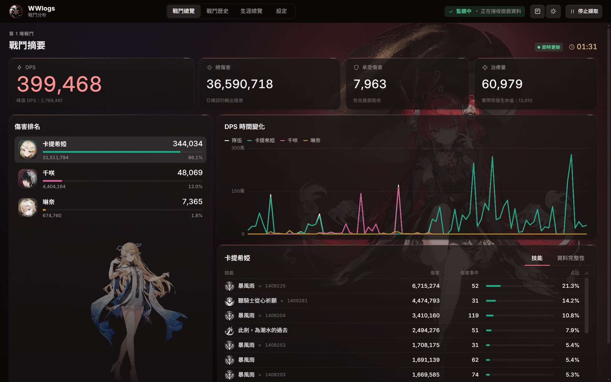
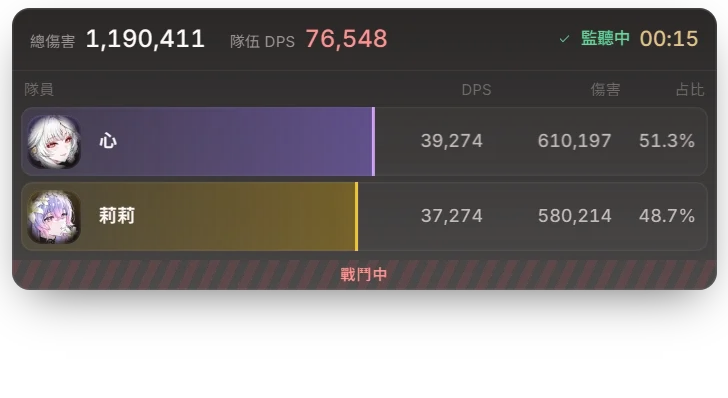
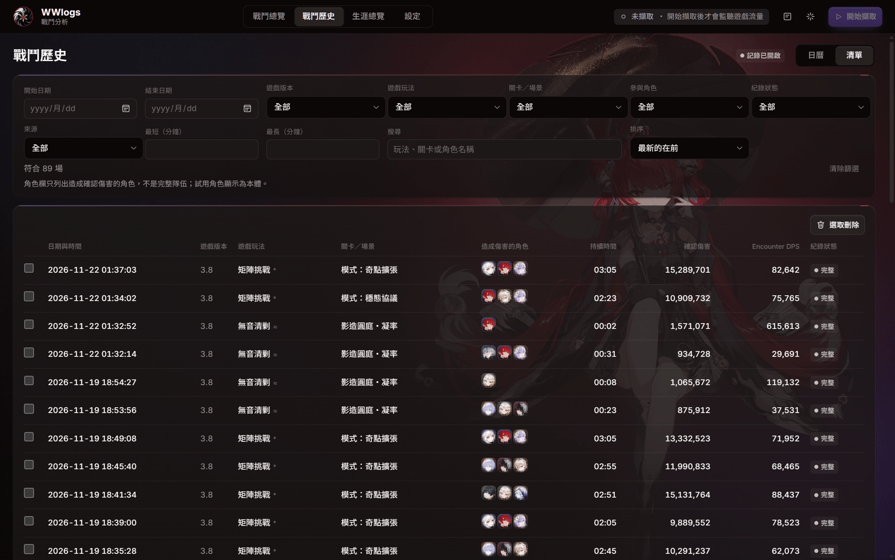
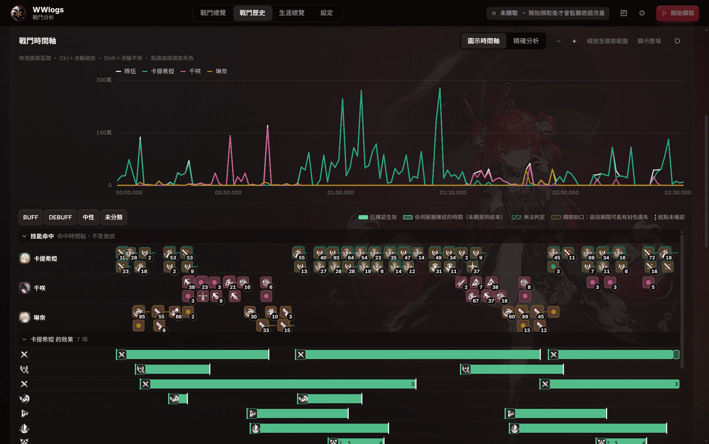
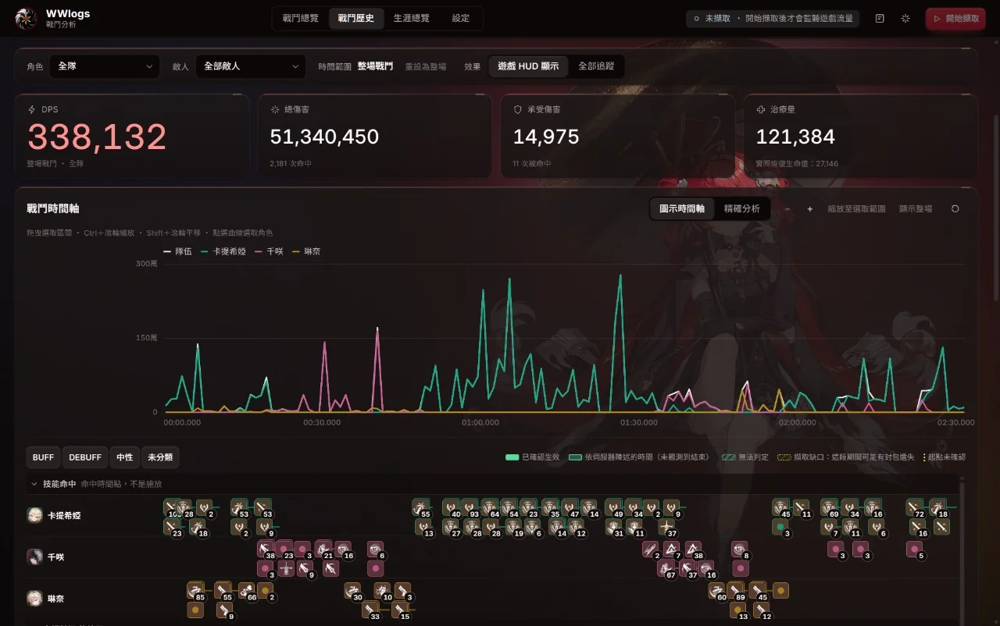
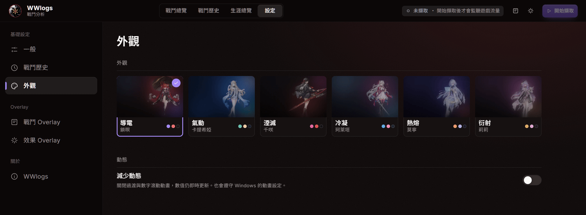

<p align="center">
  
</p>

<h1 align="center">WWlogs</h1>

<p align="center">《鳴潮》PC 版的戰鬥紀錄與分析工具：即時 DPS、BUFF／DEBUFF 追蹤與戰鬥回顧</p>

<p align="center">
  
  <a href="LICENSE"></a>
</p>

<p align="center">
  <a href="README.md">繁體中文</a> · <a href="README.en.md">English</a> · <a href="README.ja.md">日本語</a> · <a href="README.zh-CN.md">简体中文</a>
</p>

WWlogs 是《鳴潮》（Wuthering Waves）PC 版的戰鬥分析工具。它在 Windows 上透過 Npcap 讀取遊戲的網路通訊，即時顯示隊伍與各角色的 DPS、傷害與技能明細，以及遊戲 HUD 上的 BUFF／DEBUFF 狀態；每一場結束的戰鬥都會保存在你的電腦上，方便日後回顧、篩選與比較。

> [!CAUTION]
> WWlogs 是獨立開發的非官方第三方工具，不代表 KURO GAMES，也沒有取得官方認可。使用第三方工具可能伴隨風險，WWlogs 無法保證不會對你的帳號造成影響，是否使用請自行了解並評估。分享截圖、錄影或直播時，請留意畫面中的遊戲 UID、玩家名稱與其他個人資訊。



## 開發緣由

那天我興高采烈地抽到了「鎖暝」，當場決定讓她擔任隊伍的主 C。結果實際上場後才發現，她的 BUFF 觸發條件比我想像中嚴苛得多，戰鬥中也很難看清楚相關的狀態到底有沒有觸發、還剩多久。

主 C 計畫還沒開始就卡關了。既然遊戲裡看不清楚，那就自己做一個工具吧：把戰鬥記錄下來、把效果追蹤清楚、把傷害拆開來看。這就是 WWlogs 的起點。

## 主要功能

### 即時戰鬥 Overlay

兩個可以疊在遊戲畫面上的小視窗，戰鬥時不必切換畫面就能看到數據。

- **戰鬥 Overlay**：總傷害、隊伍 DPS、戰鬥時間，以及每位隊員的 DPS、傷害、占比與承受傷害；隊員依傷害高低排序，名次改變時會即時換位。
- **效果 Overlay**：以遊戲本身的圖示顯示遊戲 HUD 上的狀態。第一列是增益與中性狀態，第二列是減益；每個圖示附有估計的剩餘秒數與層數，施加在敵人身上的狀態會另外標示。
- 兩個 Overlay 可以分別開關，可設定保持在最上層、滑鼠穿透、背景不透明度與顯示倍率，並在編輯模式中拖曳位置、調整大小。

<p>
  <br>
  
</p>

### 戰鬥總覽

- **戰鬥摘要**：DPS（附 1 秒峰值 DPS）、總傷害、承受傷害（包含護盾吸收）與治療量。
- **傷害排名**：各角色的 DPS、傷害與占比。
- **DPS 時間變化**：隊伍與各角色每秒 DPS 的變化曲線。
- **技能明細**：選擇角色即可查看各技能的傷害、傷害事件數與占比；異常狀態造成的傷害會分開列出。
- **資料完整性**：擷取中若有封包遺失，DPS 會標示為下限（≥）；無法可靠計算時則不顯示。

### 戰鬥歷史

- 每一場結束的戰鬥都會自動保存，可以用活動熱度日曆或清單瀏覽。
- 清單可依日期、遊戲版本、玩法、關卡或場景、參與角色、紀錄狀態與戰鬥時長篩選，也能搜尋玩法、關卡或角色名稱，並依時間、DPS、傷害或時長排序。
- 每一場戰鬥都會記錄遊戲版本、玩法、關卡或場景，以及主要敵人。
- **比較**：最多 4 場戰鬥並排比較戰鬥時長、確認傷害、DPS、峰值 DPS、角色傷害與技能傷害分布。
- 可以刪除單場、多場或全部的戰鬥歷史。



### 單場分析：DPS 趨勢、技能與 BUFF／DEBUFF 時間軸

開啟戰鬥歷史中任一場已結束的戰鬥，即可進行事後分析。

- **戰鬥時間軸**：隊伍與各角色的 DPS 曲線、每一次技能命中，以及各效果的生效區間，排在同一條時間軸上，可以縮放與平移。
- **區間分析**：在時間軸上拖曳選取任一區間，DPS、傷害、角色排名、技能與效果統計都會改為該區間的數值；也可以只看特定角色或敵人。
- **技能**：各技能的傷害、占比、命中次數、單次最大、平均命中與整場分布。
- **效果**：各效果的持有者、覆蓋率、最高層數與施加次數。時間軸上的生效區間會依證據標示為「已確認生效」「依伺服器陳述的時間」或「無法判定」。
- **事件與敵人**：逐筆列出傷害、治療與效果變化，以及各敵人承受的傷害、被命中次數與對隊伍造成的傷害。





### 生涯總覽

依期間（近 7 天、近 30 天、全部或自訂）整理戰鬥場數、確認傷害、戰鬥時間與活躍天數，並列出個人紀錄（最高 Encounter DPS、最高確認傷害、最高 1 秒峰值 DPS、最大單次傷害）、各角色的表現、同場輸出組合、每日趨勢與玩法關卡。個人紀錄只取自完整紀錄。

### 設定、主題與語言

- **語言**：繁體中文、简体中文、English、日本語、한국어，也可以依 Windows 顯示語言自動選擇。角色、技能、敵人與玩法的名稱會以同一種語言顯示。
- **外觀**：多款以《鳴潮》角色為背景的元素主題；可以減少動態效果，也會遵守 Windows 的動畫設定。
- **擷取**：網路介面、啟動時自動開始擷取，以及戰鬥資訊的更新間隔。
- **戰鬥歷史**：可以關閉記錄，或清除全部歷史。



## 系統需求

| 項目 | 需求 |
| --- | --- |
| 作業系統 | Windows 64 位元（x64）；在 Windows 11 上開發與測試 |
| 封包擷取 | [Npcap](https://npcap.com/)，需另外安裝 |
| 執行環境 | Microsoft Edge WebView2 Runtime（Windows 11 已內建） |
| 遊戲 | 《鳴潮》PC 版 3.8（以國際服用戶端測試） |

WWlogs 只支援目前的遊戲版本。遊戲更新到新版本後，如果畫面顯示「此遊戲版本尚未支援，請更新 WWlogs」，請下載支援新遊戲版本的 WWlogs。

## 安裝與使用

以下是一般玩家的使用方式，不需要自行編譯。

1. 安裝 [Npcap](https://npcap.com/)，安裝時保留預設選項即可。
2. 從 [Releases](https://github.com/SindouYukina/WWlogs/releases) 下載 `WWlogs.exe`。WWlogs 是單一執行檔，不需要安裝。
3. 開啟 `WWlogs.exe`，在「設定 → 一般」選擇遊戲連線使用的網路介面。
4. **在登入遊戲之前**，按右上角的「開始擷取」。也可以在「設定 → 一般」開啟「啟動時自動開始擷取」。
5. 登入遊戲並開始戰鬥。戰鬥總覽與 Overlay 會即時更新，每一場結束的戰鬥會自動保存到「戰鬥歷史」。

- 頂端列右側的兩個圖示按鈕可以顯示或隱藏戰鬥 Overlay 與效果 Overlay。要移動 Overlay 或調整大小，請在「設定 → 戰鬥 Overlay」或「設定 → 效果 Overlay」進入編輯模式。
- 如果在登入遊戲之後才開始擷取，WWlogs 會提示錯過了登入。回到遊戲的登入畫面重新登入即可，不需要停止擷取。
- WWlogs 偵測不到 Npcap 時，會在畫面上提供 Npcap 官方下載連結。如果安裝 Npcap 時選擇了僅限系統管理員使用，請以系統管理員身分執行 WWlogs。
- WWlogs 同時只會執行一個；再次開啟時，會把已開啟的視窗帶回前景。

## 運作方式

WWlogs 透過 Npcap 擷取遊戲用戶端與伺服器之間的網路通訊，並在你的電腦上解析其中的戰鬥資料；傷害數值採用伺服器確認的結果。WWlogs 不讀取或修改遊戲記憶體、不注入任何程式，也不修改遊戲檔案。

WWlogs 必須看到遊戲的登入過程，才能解析該次連線的戰鬥資料，因此請在登入遊戲之前開始擷取。

## 數據說明

- **DPS（Encounter DPS）**：已確認的傷害，除以戰鬥從開始到結束的實際經過時間；動畫、切換角色與轉場的時間也包含在內。
- **總傷害**：只計入伺服器確認的傷害。歸屬未知的傷害不計入總傷害，畫面上會另外標示。
- **命中次數**：技能表統計的是傷害命中，不是技能施放次數；WWlogs 不記錄技能施放。
- **BUFF／DEBUFF**：剩餘秒數是估計值。WWlogs 只呈現效果的狀態與時間，不估算效果帶來多少傷害，也不計算 rDPS。遊戲資料中多數效果沒有名稱，因此效果以遊戲圖示顯示，分析頁另外列出效果 ID。
- **名稱旁的「≈」**：這個名稱是依遊戲資料推定的，不一定是該項目本身的官方名稱；將滑鼠停在「≈」上可以看到說明。
- **比較數值**：DPS 會因玩法、關卡、敵人與戰鬥長度而不同，不同條件下的數值無法直接比較。

## 資料與隱私

- 設定與戰鬥歷史只保存在這台電腦上（`%LOCALAPPDATA%\WWlogs`）。
- WWlogs 不會上傳戰鬥資料，也沒有遙測或自動更新功能。只有在偵測到尚未安裝 Npcap 時，才會連線到 Npcap 官方網站與 GitHub，查詢最新的 Npcap 安裝程式。
- 戰鬥歷史保存戰鬥結果、每一筆已確認的傷害與治療結果，以及效果的變化，不保存原始網路封包。

## 常見問題（FAQ）

### WWlogs 必須在登入遊戲之前開始擷取嗎？

是的。WWlogs 需要觀察遊戲的登入過程，才能取得解析該次連線所需的資訊。如果開始擷取時已經登入，WWlogs 會提示錯過了登入；回到遊戲的登入畫面重新登入即可，不需要停止擷取。若想省去這個步驟，可以在「設定 → 一般」開啟「啟動時自動開始擷取」，並在登入遊戲前先開啟 WWlogs。

### 為什麼開始擷取後沒有戰鬥資料？

請依序確認：

1. Npcap 已經安裝；WWlogs 偵測不到 Npcap 時會在畫面上提示。
2. 「設定 → 一般」選擇的是遊戲連線實際使用的網路介面。
3. 擷取是在登入遊戲之前開始的；如果錯過了登入，請回到登入畫面重新登入。
4. 目前的遊戲版本受到這個版本的 WWlogs 支援；不支援時，畫面會顯示「此遊戲版本尚未支援，請更新 WWlogs」。

頂端列的監聽狀態（例如「等待遊戲」「監聽中」）也會顯示 WWlogs 目前的情況。

### WWlogs 會讀取或修改遊戲記憶體嗎？

不會。WWlogs 只透過 Npcap 擷取遊戲用戶端與伺服器之間的網路通訊，並在你的電腦上解析其中的戰鬥資料；它不讀取或修改遊戲記憶體、不注入任何程式，也不修改遊戲檔案。

### 使用 WWlogs 有封號風險嗎？

WWlogs 是非官方第三方工具，沒有取得 KURO GAMES 的授權、認可或背書。上述的技術設計不等於零風險，WWlogs 無法保證使用後不會對帳號造成影響。是否使用，請自行了解遊戲的相關規定並評估風險。

### 為什麼 WWlogs 的 DPS 和其他工具不同？

WWlogs 的 DPS（Encounter DPS）是戰鬥中已確認的傷害，除以戰鬥從開始到結束的實際經過時間；動畫、切換角色與轉場的時間也包含在內。其他工具若採用不同的時間範圍或計算方式，數值自然會不同。此外，擷取是否完整（有封包遺失時，DPS 會標示為下限）以及傷害能否確認歸屬（歸屬未知的傷害不計入總傷害），也會影響結果。詳見[數據說明](#數據說明)。

### 為什麼部分 BUFF／DEBUFF 沒有名稱，或剩餘時間不準確？

遊戲資料中多數效果沒有可用的官方名稱：效果 Overlay 只顯示遊戲圖示，分析頁則以「未識別效果」加上效果 ID 標示這些效果，不會自行替它們命名。效果 Overlay 的剩餘秒數是估計值；分析頁的生效區間會依證據標示為「已確認生效」「依伺服器陳述的時間」或「無法判定」，WWlogs 不會把推定的結果當成已驗證的事實。

### WWlogs 會上傳我的戰鬥資料嗎？

不會。戰鬥分析與戰鬥歷史都保存在你的電腦上，WWlogs 不上傳戰鬥紀錄，也沒有遙測或雲端帳號同步。WWlogs 本身只會在一種情況下連線網路：偵測到尚未安裝 Npcap 時，向 Npcap 官方網站與 GitHub 查詢最新的 Npcap 安裝程式。

### 遊戲更新後無法解析怎麼辦？

WWlogs 只支援目前經過確認的遊戲版本，不保證與其他版本相容。遊戲更新後如果畫面顯示「此遊戲版本尚未支援，請更新 WWlogs」，請等待支援新遊戲版本的 WWlogs 正式更新。

### 支援 PS5、Linux 或 macOS 嗎？

目前只支援 Windows PC 版。WWlogs 沒有 PS5、Linux、macOS 或遠端擷取的版本，也不承諾未來會推出。

### 可以自行編譯 WWlogs 嗎？

可以。WWlogs 的原始碼以 AGPL-3.0-only 授權公開，你可以依照授權條款使用、修改與散布。建置方式請見[開發與建置](#開發與建置)。建置所需的外部金鑰必須自行準備；本專案不提供金鑰，也不提供或討論取得方法。

### WWlogs 可以匯出戰鬥 Log 嗎？

不行，這是刻意的產品設計，而不是技術限制。WWlogs 的目的是幫助你分析自己的戰鬥表現、理解技能與 BUFF／DEBUFF、改善自己的操作；WWlogs 反對以 DPS 為核心的玩家間競爭（PVP）機制。因此 WWlogs 官方版本：

- 不提供原始戰鬥 Log 匯出；
- 不提供可重建或交換戰鬥紀錄的 CSV、JSON 等明文資料匯出；
- 不提供公開的 DPS 排行榜；
- 不提供官方的跨玩家戰鬥紀錄比較服務。

WWlogs 鼓勵的是跟自己比、持續進步，而不是玩家之間的數值競爭。

### 更換電腦後，可以繼承原本的戰鬥歷史嗎？

不行。戰鬥歷史只供建立紀錄的那台電腦在本機使用；換到新電腦後，即使複製原本的紀錄檔案，也無法直接在新電腦上讀取。WWlogs 官方版本不提供跨電腦的移轉、還原或繼承功能，新電腦上的戰鬥歷史會重新開始累積。這與 WWlogs 專注於個人分析、反對 DPS 競爭的方向一致。

## 開發與建置

一般玩家請依照[安裝與使用](#安裝與使用)下載正式版本，不需要自行編譯。本節提供給想從原始碼建置 WWlogs 的開發者。

**需要的環境**

- Windows x64 與 PowerShell 7（`pwsh`）。
- Go：`go.mod` 指定的版本以上（目前為 1.27.4）。建置腳本會設定 `GOTOOLCHAIN=local`，只使用系統安裝的 Go，不會自動下載其他版本。
- Node.js 與 npm：版本需符合 `frontend/package.json` 的 `engines`（目前為 Node.js `>=26.13.1 <27`、npm `>=12.2.2 <13`）。前端依賴會依照 `frontend/package-lock.json` 安裝。
- 外部金鑰（見下方說明）。

**外部金鑰**

建置時需要一份外部金鑰：2048 位元、PKCS#1 格式的 RSA 私鑰 PEM 檔，放在 `.local/keys/privateKey.pem`（`.local/` 不納入 Git）；缺少這份檔案時，建置會直接停止。金鑰必須由開發者自行準備：WWlogs 不提供任何金鑰，也不提供或討論取得方法。

**建置**

```powershell
git clone https://github.com/SindouYukina/WWlogs.git
cd WWlogs
pwsh -File scripts/build.ps1 -Profile Public
```

- 完成的執行檔位於 `bin\public\WWlogs.exe`。`-Profile Development` 會建置含診斷與重播功能的開發版本（`bin\development\WWlogs.exe`），只供開發與研究使用；對外散布的版本一律是 Public。`-Profile Both` 會一次建置兩者。
- 從原始碼建置的執行檔會標示為非正式建置（Unofficial）；正式的建置編號只由專案擁有者的建置環境配發。自行建置的執行檔不保證與正式發布版位元組完全相同。
- 建置流程、建置編號與其他選項的詳細說明，請見 [build/windows/README.md](build/windows/README.md)。

## 致謝

WWlogs 的許多設計受到下列專案的啟發，在此致上謝意。這些專案與 WWlogs 沒有合作、贊助或背書關係；WWlogs 參考的是它們的設計與理念，沒有使用它們的程式碼或資料。

### 核心啟發

- **[FF Logs](https://www.fflogs.com/) 與 [xivanalysis](https://xivanalysis.com/)**：深入分析戰鬥紀錄的理念，包括單場戰鬥回顧、以技能事件與戰鬥時間軸呈現戰鬥、BUFF／DEBUFF 的覆蓋分析，以及透過戰鬥資料理解並改善自己的操作。WWlogs 參考的是它們的分析深度與資訊呈現方式，而不是公開排行榜或玩家之間的競爭模式。
- **[ZMDLogs](https://github.com/deepdarkssj/ZMDLogs)**：把封包擷取、協定解析與資料呈現分層處理的設計，以及即時傷害 Overlay 與 BUFF／DEBUFF Overlay 的資訊組織方式。ZMDLogs 分析的是另一款遊戲，兩者的協定並不相容。
- **[A2Tools DPS Meter](https://github.com/taengu/A2Tools-DPS-Meter)**：DPS 儀表板的資訊組織、傷害數據的呈現方式，以及傷害條與其動態效果。

### 設計與研究參考

- **[AionMeter](https://tmopcode.github.io/AionMeter/)／[AionFlex](https://aionflex.gg/)**：Overlay 的外觀與資訊呈現、效果即將到期時的提示，以及 Overlay 設定項目的規劃。
- **[Iridium-Ww](https://github.com/WutheringWavesGame/Iridium-Ww)**：早期的 UDP／KCP 協定研究，以及擷取、分框與解析分層的思路。這是較早期的歷史研究參考，其協定資料不適用於目前的遊戲版本。
- **[Kokonut UI](https://kokonutui.com/)／[easeUI](https://easeui.dev/)**：分段控制項（Segmented Control）的移動指示器、互動動態，以及短轉場與版面運算方式的設計參考。

WWlogs 實際使用的第三方函式庫、字型，以及複製進專案的程式碼（例如 shadcn/ui 元件），其著作權與授權列在 [THIRD_PARTY_NOTICES.md](THIRD_PARTY_NOTICES.md)，也可以在程式的「設定 → 授權」中查看。

## 授權與聲明

Copyright (C) 2026 SindouYukina

WWlogs 為自由軟體；可依自由軟體基金會發布的 GNU Affero General Public License v3.0 only（SPDX：`AGPL-3.0-only`）條款，再散布及／或修改本程式。WWlogs 是基於能有所助益的期望而散布，但不負任何擔保責任；亦不含對適售性或特定目的適用性的默示擔保。授權條款全文請參閱 [LICENSE](LICENSE)。

上述著作權與 AGPL-3.0-only 授權僅適用於 WWlogs 自有的原始碼。《鳴潮》遊戲素材、內建字型與第三方函式庫依其各自的權利與授權提供，詳見 [THIRD_PARTY_NOTICES.md](THIRD_PARTY_NOTICES.md)。

《鳴潮》（Wuthering Waves）的遊戲美術與智慧財產權，歸 KURO GAMES 或其各自的合法權利人所有，包括 WWlogs 與本頁截圖中的角色圖像、技能圖示、效果圖示、主題背景及相關衍生設計。上述素材不屬於 WWlogs 自有的原始碼，不在其 AGPL-3.0-only 授權範圍內。

WWlogs 是獨立開發的非官方工具，不代表 KURO GAMES，也未宣稱與其有任何官方合作、贊助或背書關係。《鳴潮》官方網站：<https://wutheringwaves.kurogames.com/>
