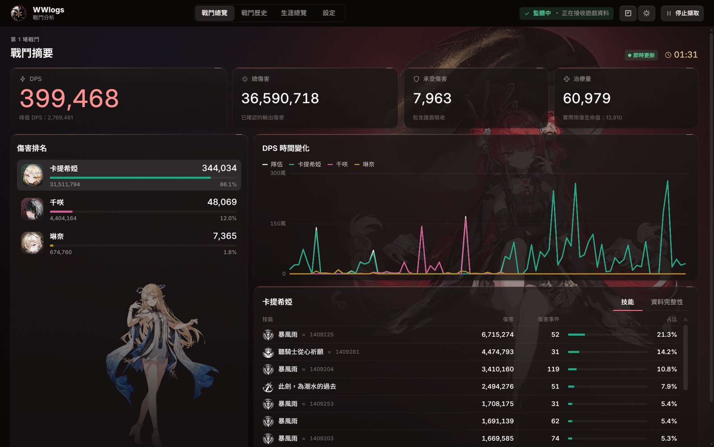
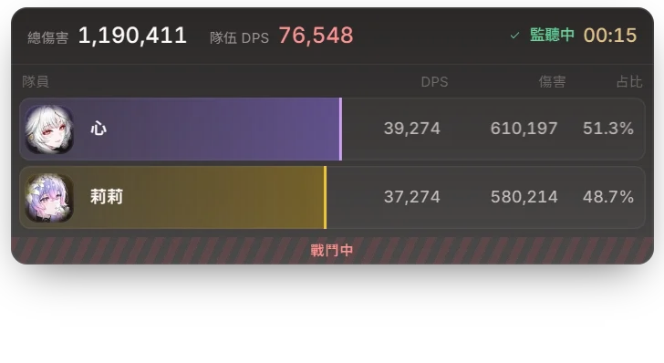
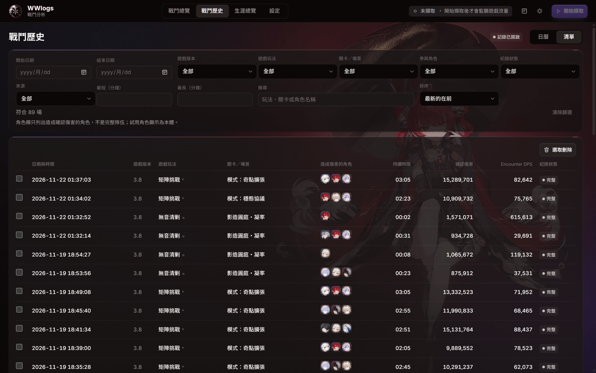
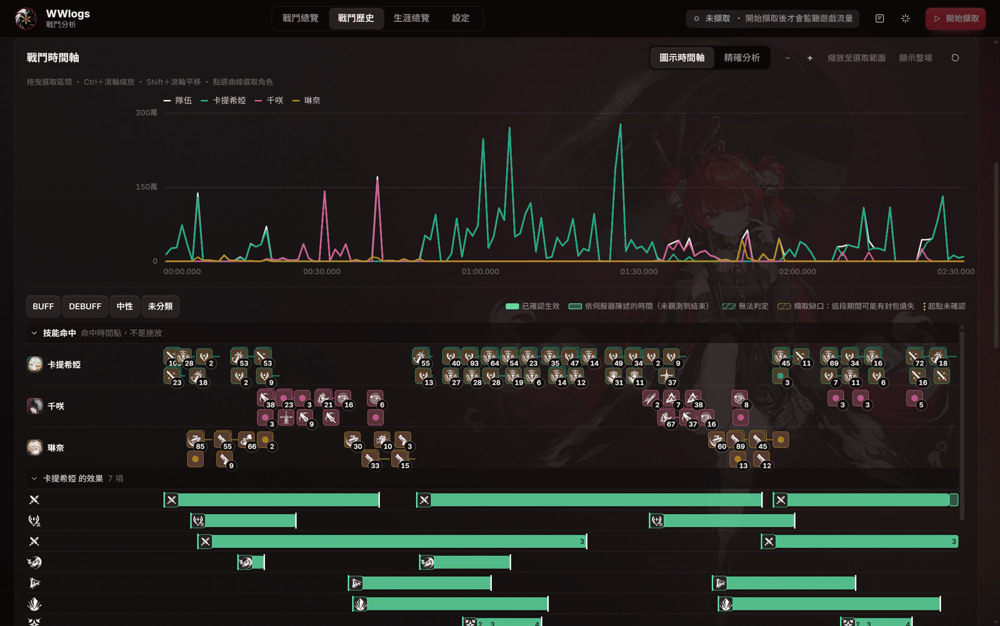
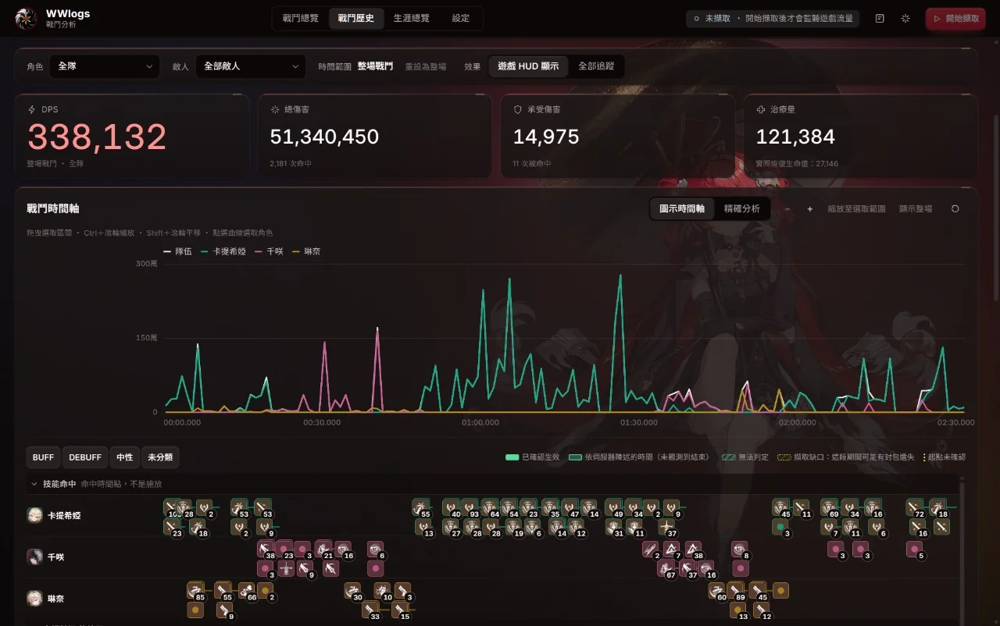
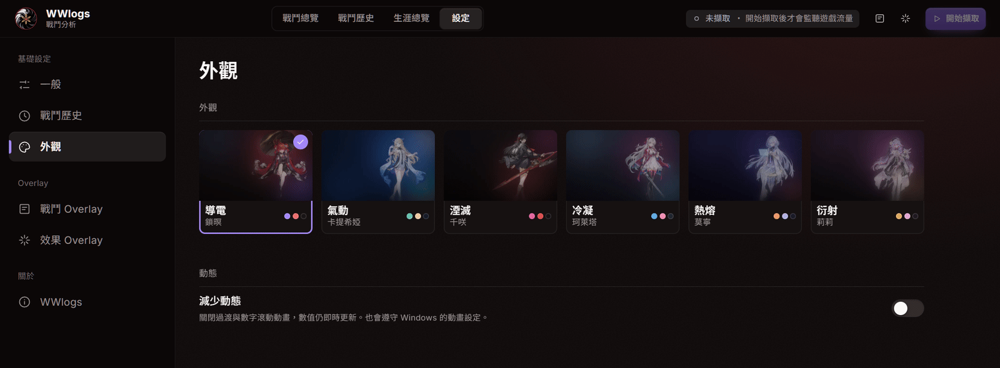

<p align="center">
  
</p>

<h1 align="center">WWlogs</h1>

<p align="center">《鸣潮》PC 版的战斗记录与分析工具：实时 DPS、BUFF／DEBUFF 追踪与战斗回顾</p>

<p align="center">
  
  <a href="LICENSE"></a>
</p>

<p align="center">
  <a href="README.md">繁體中文</a> · <a href="README.en.md">English</a> · <a href="README.ja.md">日本語</a> · <a href="README.zh-CN.md">简体中文</a> · <a href="README.ko.md">한국어</a>
</p>

WWlogs 是《鸣潮》（Wuthering Waves）PC 版的战斗分析工具。它在 Windows 上通过 Npcap 读取游戏的网络通信，实时显示队伍与各角色的 DPS、伤害与技能明细，以及游戏 HUD 上的 BUFF／DEBUFF 状态；每一场结束的战斗都会保存在你的电脑上，方便日后回顾、筛选与比较。

> [!CAUTION]
> WWlogs 是非官方的第三方工具，使用风险请自行评估。使用前请阅读[免责声明](#免责声明)与[安全使用](#安全使用)。



## 开发缘由

攒了大半年的十六万星声，准备抽“锁暝”，想让她当主 C。结果实际玩了才发现，她的 BUFF 触发条件比我想象中还要苛刻，没有打在强化 BUFF 内根本就是垃圾伤害，而且战斗的时候根本很难看清楚到底有没有成功触发。

一怒之下怒了一下，自己写个工具，把战斗记录下来直接分析不就好了？本来只是想解决这个问题，结果做着做着，功能越来越多，最后就变成了现在的 WWlogs。

## 主要功能

### 实时战斗 Overlay

两个可以叠在游戏画面上的小窗口，战斗时不必切换画面就能看到数据。

- **战斗 Overlay**：总伤害、队伍 DPS、战斗时间，以及每位队员的 DPS、伤害、占比与承受伤害；队员按伤害高低排序，名次变化时会实时换位。
- **效果 Overlay**：以游戏本身的图标显示游戏 HUD 上的状态。第一行是增益与中性状态，第二行是减益；每个图标附有估计的剩余秒数与层数，施加在敌人身上的状态会另外标示。
- 两个 Overlay 可以分别开关，可设置保持在最上层、鼠标穿透、背景不透明度与显示倍率，并在编辑模式中拖动位置、调整大小。

<p>
  <br>
  
</p>

### 战斗总览

- **战斗摘要**：DPS（附 1 秒峰值 DPS）、总伤害、承受伤害（包含护盾吸收）与治疗量。
- **伤害排名**：各角色的 DPS、伤害与占比。
- **DPS 时间变化**：队伍与各角色每秒 DPS 的变化曲线。
- **技能明细**：选择角色即可查看各技能的伤害、伤害事件数与占比；异常状态造成的伤害会分开列出。
- **数据完整性**：采集过程中若有数据包丢失，DPS 会标示为下限（≥）；无法可靠计算时则不显示。

### 战斗历史

- 每一场结束的战斗都会自动保存，可以用活动热度日历或列表浏览。
- 列表可按日期、游戏版本、玩法、关卡或场景、参与角色、记录状态与战斗时长筛选，也能搜索玩法、关卡或角色名称，并按时间、DPS、伤害或时长排序。
- 每一场战斗都会记录游戏版本、玩法、关卡或场景，以及主要敌人。
- **比较**：最多 4 场战斗并排比较战斗时长、确认伤害、DPS、峰值 DPS、角色伤害与技能伤害分布。
- 可以删除单场、多场或全部的战斗历史。



### 单场分析：DPS 趋势、技能与 BUFF／DEBUFF 时间轴

打开战斗历史中任意一场已结束的战斗，即可进行事后分析。

- **战斗时间轴**：队伍与各角色的 DPS 曲线、每一次技能命中，以及各效果的生效区间，排在同一条时间轴上，可以缩放与平移。
- **区间分析**：在时间轴上拖动选取任意区间，DPS、伤害、角色排名、技能与效果统计都会改为该区间的数值；也可以只看特定角色或敌人。
- **技能**：各技能的伤害、占比、命中次数、单次最大、平均命中与整场分布。
- **效果**：各效果的持有者、覆盖率、最高层数与施加次数。时间轴上的生效区间会按证据标示为“已确认生效”“按服务器陈述的时间”或“无法判定”。
- **事件与敌人**：逐条列出伤害、治疗与效果变化，以及各敌人承受的伤害、被命中次数与对队伍造成的伤害。





### 生涯总览

按时间段（近 7 天、近 30 天、全部或自定义）整理战斗场数、确认伤害、战斗时间与活跃天数，并列出个人纪录（最高 Encounter DPS、最高确认伤害、最高 1 秒峰值 DPS、最大单次伤害）、各角色的表现、同场输出组合、每日趋势与玩法关卡。个人纪录只取自完整记录。

### 设置、主题与语言

- **语言**：繁體中文、简体中文、English、日本語、한국어，也可以按 Windows 显示语言自动选择。角色、技能、敌人与玩法的名称会以同一种语言显示。
- **外观**：多款以《鸣潮》角色为背景的元素主题；可以减少动态效果，也会遵循 Windows 的动画设置。
- **采集**：网络接口、启动时自动开始采集，以及战斗信息的更新间隔。
- **战斗历史**：可以关闭记录，或清除全部历史。



## 系统要求

| 项目 | 要求 |
| --- | --- |
| 操作系统 | Windows 64 位（x64）；在 Windows 11 上开发与测试 |
| 数据包采集 | [Npcap](https://npcap.com/)，需另行安装 |
| 运行环境 | Microsoft Edge WebView2 Runtime（Windows 11 已内置） |

WWlogs 仅支持经确认的现行游戏版本。游戏更新后若出现版本不支持的提示，请等待或下载对应的 WWlogs 正式更新。

## 安装与使用

以下是普通玩家的使用方式，不需要自行编译。

1. 安装 [Npcap](https://npcap.com/)，安装时保留默认选项即可。
2. 从 [Releases](https://github.com/SindouYukina/WWlogs/releases) 下载 `WWlogs.exe`。WWlogs 是单个可执行文件，无需安装。
3. 打开 `WWlogs.exe`，在“设置 → 常规”中选择游戏连接使用的网络接口。
4. **在登录游戏之前**，点击右上角的“开始采集”。也可以在“设置 → 常规”中开启“启动时自动开始采集”。
5. 登录游戏并开始战斗。战斗总览与 Overlay 会实时更新，每一场结束的战斗会自动保存到“战斗历史”。

- 顶栏右侧的两个图标按钮可以显示或隐藏战斗 Overlay 与效果 Overlay。要移动 Overlay 或调整大小，请在“设置 → 战斗 Overlay”或“设置 → 效果 Overlay”中进入编辑模式。
- 如果在登录游戏之后才开始采集，WWlogs 会提示错过了登录。回到游戏的登录界面重新登录即可，不需要停止采集。
- WWlogs 检测不到 Npcap 时，会在界面上提供 Npcap 官方下载链接。如果安装 Npcap 时选择了仅限管理员使用，请以管理员身份运行 WWlogs。
- WWlogs 同时只会运行一个；再次打开时，会把已打开的窗口切回前台。

## 工作原理

WWlogs 通过 Npcap 采集游戏客户端与服务器之间的网络通信，并在你的电脑上解析其中的战斗数据；伤害数值采用服务器确认的结果。WWlogs 的技术行为与使用注意事项，请见[安全使用](#安全使用)。

WWlogs 必须看到游戏的登录过程，才能解析该次连接的战斗数据，因此请在登录游戏之前开始采集。

## 数据说明

- **DPS（Encounter DPS）**：已确认的伤害，除以战斗从开始到结束的实际经过时间；动画、切换角色与转场的时间也包含在内。
- **总伤害**：只计入服务器确认的伤害。归属未知的伤害不计入总伤害，界面上会另外标示。
- **命中次数**：技能表统计的是伤害命中，不是技能施放次数；WWlogs 不记录技能施放。
- **BUFF／DEBUFF**：剩余秒数是估计值。WWlogs 只呈现效果的状态与时间，不估算效果带来多少伤害，也不计算 rDPS。游戏数据中多数效果没有名称，因此效果以游戏图标显示，分析页另外列出效果 ID。
- **名称旁的“≈”**：这个名称是根据游戏数据推定的，不一定是该项目本身的官方名称；将鼠标停在“≈”上可以看到说明。
- **比较数值**：DPS 会因玩法、关卡、敌人与战斗长度而不同，不同条件下的数值无法直接比较。

## 数据与隐私

- 设置与战斗历史只保存在这台电脑上（`%LOCALAPPDATA%\WWlogs`）。
- WWlogs 不会上传战斗数据，也没有遥测或自动更新功能。只有在检测到尚未安装 Npcap 时，才会连接到 Npcap 官方网站与 GitHub，查询最新的 Npcap 安装程序。
- 战斗历史保存战斗结果、每一条已确认的伤害与治疗结果，以及效果的变化，不保存原始网络数据包。

## 安全使用

**技术行为**

- WWlogs 通过 Npcap 采集游戏客户端与服务器之间的网络通信，不修改采集到的网络数据包。
- WWlogs 不读取或修改游戏内存，不注入游戏进程，也不修改游戏文件。

这些是 WWlogs 的技术设计，不代表使用时没有账号风险，也不代表已获得 KURO GAMES 的许可；请一并阅读[免责声明](#免责声明)。

**截图、录像与直播**

分享 WWlogs 或游戏的截图、录制视频或直播时，请留意画面中的游戏 UID、玩家名称与其他可能识别你的信息；分享之前，请自行确认画面内容。

## 常见问题（FAQ）

<details>
<summary>WWlogs 必须在登录游戏之前开始采集吗？</summary>

是的。WWlogs 需要观察游戏的登录过程，才能获取解析该次连接所需的信息。如果开始采集时已经登录，WWlogs 会提示错过了登录；回到游戏的登录界面重新登录即可，不需要停止采集。若想省去这个步骤，可以在“设置 → 常规”中开启“启动时自动开始采集”，并在登录游戏前先打开 WWlogs。

</details>

<details>
<summary>为什么开始采集后没有战斗数据？</summary>

请依次确认：

1. Npcap 已经安装；WWlogs 检测不到 Npcap 时会在界面上提示。
2. “设置 → 常规”中选择的是游戏连接实际使用的网络接口。
3. 采集是在登录游戏之前开始的；如果错过了登录，请回到登录界面重新登录。
4. 当前的游戏版本受到这个版本的 WWlogs 支持；不支持时，界面会显示“此游戏版本尚未支持，请更新 WWlogs”。

顶栏的监听状态（例如“等待游戏”“监听中”）也会显示 WWlogs 当前的情况。

</details>

<details>
<summary>WWlogs 会读取或修改游戏内存吗？</summary>

不会。WWlogs 只通过 Npcap 采集游戏客户端与服务器之间的网络通信，并在你的电脑上解析其中的战斗数据；它不读取或修改游戏内存、不注入任何程序，也不修改游戏文件。详见[安全使用](#安全使用)。

</details>

<details>
<summary>使用 WWlogs 有封号风险吗？</summary>

WWlogs 是非官方第三方工具，没有获得 KURO GAMES 的授权、认可或背书。[安全使用](#安全使用)中说明的技术设计不等于零风险，WWlogs 无法保证使用后不会对账号造成影响。是否使用，请自行了解游戏的相关规定并评估风险；详见[免责声明](#免责声明)。

</details>

<details>
<summary>为什么部分 BUFF／DEBUFF 没有名称，或剩余时间不准确？</summary>

游戏数据中多数效果没有可用的官方名称：效果 Overlay 只显示游戏图标，分析页则以“未识别效果”加上效果 ID 标示这些效果，不会自行为它们命名。效果 Overlay 的剩余秒数是估计值；分析页的生效区间会按证据标示为“已确认生效”“按服务器陈述的时间”或“无法判定”，WWlogs 不会把推定的结果当成已验证的事实。

</details>

<details>
<summary>WWlogs 会上传我的战斗数据吗？</summary>

不会。战斗分析与战斗历史都保存在你的电脑上，WWlogs 不上传战斗记录，也没有遥测或云端账号同步。WWlogs 本身只会在一种情况下连接网络：检测到尚未安装 Npcap 时，向 Npcap 官方网站与 GitHub 查询最新的 Npcap 安装程序。

</details>

<details>
<summary>游戏更新后无法解析怎么办？</summary>

WWlogs 只支持当前经过确认的游戏版本，不保证与其他版本兼容。游戏更新后如果界面显示“此游戏版本尚未支持，请更新 WWlogs”，请等待支持新游戏版本的 WWlogs 正式更新。

</details>

<details>
<summary>支持 PS5、Linux 或 macOS 吗？</summary>

目前只支持 Windows PC 版。WWlogs 没有 PS5、Linux、macOS 或远程采集的版本，也不承诺未来会推出。

</details>

<details>
<summary>可以自行编译 WWlogs 吗？</summary>

可以。WWlogs 的源代码以 AGPL-3.0-only 授权公开，你可以依照授权条款使用、修改与分发。构建方法请见[开发与构建](#开发与构建)。构建所需的外部密钥必须自行准备；本项目不提供密钥，也不提供或讨论获取方法。

</details>

<details>
<summary>WWlogs 可以导出战斗 Log 吗？</summary>

不行，这是刻意的产品设计，而不是技术限制。WWlogs 的目的是帮助你分析自己的战斗表现、理解技能与 BUFF／DEBUFF、改善自己的操作；WWlogs 反对以 DPS 为核心的玩家间竞争（PVP）机制。因此 WWlogs 官方版本：

- 不提供原始战斗 Log 导出；
- 不提供可重建或交换战斗记录的 CSV、JSON 等明文数据导出；
- 不提供公开的 DPS 排行榜；
- 不提供官方的跨玩家战斗记录比较服务。

WWlogs 鼓励的是跟自己比、持续进步，而不是玩家之间的数值竞争。

</details>

<details>
<summary>更换电脑后，可以继承原本的战斗历史吗？</summary>

不行。战斗历史只供创建记录的那台电脑在本机使用；换到新电脑后，即使复制原本的记录文件，也无法直接在新电脑上读取。WWlogs 官方版本不提供跨电脑的迁移、还原或继承功能，新电脑上的战斗历史会重新开始积累。这与 WWlogs 专注于个人分析、反对 DPS 竞争的方向一致。

</details>

## 开发与构建

普通玩家请按照[安装与使用](#安装与使用)下载正式版本，不需要自行编译。本节提供给想从源代码构建 WWlogs 的开发者。

**需要的环境**

- Windows x64 与 PowerShell 7（`pwsh`）。
- Go：`go.mod` 指定的版本及以上（目前为 1.27.4）。构建脚本会设置 `GOTOOLCHAIN=local`，只使用系统安装的 Go，不会自动下载其他版本。
- Node.js 与 npm：版本需符合 `frontend/package.json` 的 `engines`（目前为 Node.js `>=26.13.1 <27`、npm `>=12.2.2 <13`）。前端依赖会按照 `frontend/package-lock.json` 安装。
- 外部密钥（见下方说明）。

**外部密钥**

构建时需要一份外部密钥：2048 位、PKCS#1 格式的 RSA 私钥 PEM 文件，放在 `.local/keys/privateKey.pem`（`.local/` 不纳入 Git）；缺少这个文件时，构建会直接停止。密钥必须由开发者自行准备：WWlogs 不提供任何密钥，也不提供或讨论获取方法。

**构建**

```powershell
git clone https://github.com/SindouYukina/WWlogs.git
cd WWlogs
pwsh -File scripts/build.ps1 -Profile Public
```

- 完成的可执行文件位于 `bin\public\WWlogs.exe`。`-Profile Development` 会构建包含诊断与重放功能的开发版本（`bin\development\WWlogs.exe`），仅供开发与研究使用；对外分发的版本一律是 Public。`-Profile Both` 会一次构建两者。
- 从源代码构建的可执行文件会标示为非正式构建（Unofficial）；正式的构建编号只由项目所有者的构建环境分配。自行构建的可执行文件不保证与正式发布版逐字节相同。
- 构建流程、构建编号与其他选项的详细说明，请见 [build/windows/README.md](build/windows/README.md)。

## 致谢

WWlogs 的许多设计受到下列项目的启发，在此致以谢意。这些项目与 WWlogs 没有合作、赞助或背书关系；WWlogs 参考的是它们的设计与理念，没有使用它们的代码或数据。

### 核心启发

- **[FF Logs](https://www.fflogs.com/) 与 [xivanalysis](https://xivanalysis.com/)**：深入分析战斗记录的理念，包括单场战斗回顾、以技能事件与战斗时间轴呈现战斗、BUFF／DEBUFF 的覆盖分析，以及通过战斗数据理解并改善自己的操作。WWlogs 参考的是它们的分析深度与信息呈现方式，而不是公开排行榜或玩家之间的竞争模式。
- **[ZMDLogs](https://github.com/deepdarkssj/ZMDLogs)**：把数据包采集、协议解析与数据呈现分层处理的设计，以及实时伤害 Overlay 与 BUFF／DEBUFF Overlay 的信息组织方式。ZMDLogs 分析的是另一款游戏，两者的协议并不兼容。
- **[A2Tools DPS Meter](https://github.com/taengu/A2Tools-DPS-Meter)**：DPS 仪表板的信息组织、伤害数据的呈现方式，以及伤害条与其动态效果。

### 设计与研究参考

- **[AionMeter](https://tmopcode.github.io/AionMeter/)／[AionFlex](https://aionflex.gg/)**：Overlay 的外观与信息呈现、效果即将到期时的提示，以及 Overlay 设置项的规划。
- **[Iridium-Ww](https://github.com/WutheringWavesGame/Iridium-Ww)**：早期的 UDP／KCP 协议研究，以及采集、分帧与解析分层的思路。这是较早期的历史研究参考，其协议数据不适用于当前的游戏版本。
- **[Kokonut UI](https://kokonutui.com/)／[easeUI](https://easeui.dev/)**：分段控件（Segmented Control）的移动指示器、交互动效，以及短转场与布局计算方式的设计参考。

WWlogs 实际使用的第三方库、字体，以及复制进项目的代码（例如 shadcn/ui 组件），其著作权与授权列在 [THIRD_PARTY_NOTICES.md](THIRD_PARTY_NOTICES.md)，也可以在程序的“设置 → 授权”中查看。

## 免责声明

- WWlogs 是独立开发的非官方第三方工具，不代表 KURO GAMES，也不声称获得 KURO GAMES 的授权、认可、合作、赞助或背书。《鸣潮》相关素材的权利归属，见[授权与声明](#授权与声明)。
- 使用第三方工具可能伴随风险，WWlogs 无法保证不会对你的账号造成影响。使用前请自行了解游戏的相关规定并评估风险。
- WWlogs 依据 AGPL-3.0-only 授权条款，在适用法律允许的范围内按“现状”提供，不附任何明示或默示的担保。完整的无担保与责任限制条款，见 [LICENSE](LICENSE) 第 15、16 条。

## 授权与声明

Copyright (C) 2026 SindouYukina

WWlogs 是自由软件；可以依据自由软件基金会发布的 GNU Affero General Public License v3.0 only（SPDX：`AGPL-3.0-only`）条款，再分发和／或修改本程序。发布 WWlogs 是希望它能够有用，但不提供任何担保；甚至不包含对适销性或特定用途适用性的默示担保。授权条款全文请参阅 [LICENSE](LICENSE)。

上述著作权与 AGPL-3.0-only 授权仅适用于 WWlogs 自有的源代码。《鸣潮》游戏素材、内置字体与第三方库依其各自的权利与授权提供，详见 [THIRD_PARTY_NOTICES.md](THIRD_PARTY_NOTICES.md)。

《鸣潮》（Wuthering Waves）的游戏美术与知识产权，归 KURO GAMES 或其各自的合法权利人所有，包括 WWlogs 与本页截图中的角色图像、技能图标、效果图标、主题背景及相关衍生设计。上述素材不属于 WWlogs 自有的源代码，不在其 AGPL-3.0-only 授权范围内。

WWlogs 是独立开发的非官方工具，不代表 KURO GAMES，也未声称与其存在任何官方合作、赞助或背书关系。《鸣潮》官方网站：<https://wutheringwaves.kurogames.com/>
